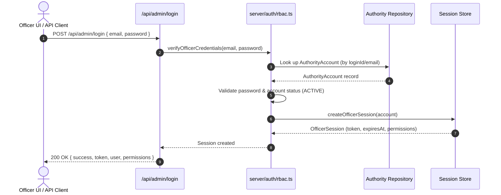

# BlockBallot — Authority Architecture, Operational Roles & Backend RBAC

> **Academic Prototype & Research Architecture Notice**  
> This specification documents the Role-Based Access Control (RBAC) and authority account model for the BlockBallot academic election simulation system.  
> **DISCLAIMER:** The accounts, identifiers (`EO-SIM-001`, `VRO-SIM-001`), credentials, and jurisdiction assignments described herein are strictly synthetic simulations for local evaluation and security analysis. They do **not** represent authentic Election Commission of India (ECI) personnel, real government identity systems, or legally authorized public election infrastructure.

---

## 1. Overview and Operational Role Structure

BlockBallot enforces a strict separation of administrative responsibilities to prevent single-point compromise and satisfy the principle of least privilege. In this release (Phase 03), the operational authority model defines **exactly two operational officer roles**, alongside a separate, isolated local **platform administrator** development account.

```mermaid
graph TD
    subgraph Authority Roles
        EO["Election Officer<br/><code>EO-SIM-001</code>"]
        VRO["Voter Registration Officer<br/><code>VRO-SIM-001</code>"]
        PA["Platform Administrator<br/><code>demo.admin@blockballot.local</code>"]
    end

    subgraph Permitted Domains
        EM["Election Management & Lifecycle<br/>(Create, Activate, Pause, Conclude, Candidates)"]
        VR["Voter Registry & Biometric Stubs<br/>(Voter Read, Stubs for Phase 04/05/06)"]
        SYS["System Administration & Dev Overrides<br/>(Local Dev Seeding, Schema Testing)"]
    end

    EO -->|Authorized| EM
    EO -.->|Forbidden (403)| VR

    VRO -->|Authorized| VR
    VRO -.->|Forbidden (403)| EM

    PA -->|Local Dev Superuser| SYS
    PA -->|Local Dev All Permissions| EM
    PA -->|Local Dev All Permissions| VR
```

### 1.1 Operational Roles and Identifiers

| Role Title | Role Key (`AuthorityRole`) | Simulation Identifier | Default Email / Login ID | Assigned Simulation Scope |
| :--- | :--- | :--- | :--- | :--- |
| **Election Officer** | `ELECTION_OFFICER` | `EO-SIM-001` | `eo.sim001@blockballot.local` | `CONST-04-ND` (New Delhi), `CONST-77-VAR` (Varanasi) |
| **Voter Registration Officer** | `VOTER_REGISTRATION_OFFICER` | `VRO-SIM-001` | `vro.sim001@blockballot.local` | `CONST-04-ND` (New Delhi) |

### 1.2 Separation from System Administrator
- **Platform Administrator (`PLATFORM_ADMIN`)**:
  - Identifier: `demo.admin@blockballot.local`
  - Function: Local platform/system maintenance for automated end-to-end testing and development.
  - **Not an operational officer role**: System administrators do not conduct live polling or registration duties.
  - **Production Safeguard**: Password-based authentication for the demo administrator (and all demo accounts) is strictly disabled when `NODE_ENV === 'production'`.

---

## 2. Centralized Permission Registry & Policy Matrix

All permissions in BlockBallot are defined as strongly typed string literals in [src/types/permissions.ts](file:///e:/Projects/BlockBallot-EVoting-System/src/types/permissions.ts). No dynamic or arbitrary permissions can be introduced by browser payloads.

### 2.1 Permission Catalogue

| Permission Name | Category | Description |
| :--- | :--- | :--- |
| `ELECTION_READ` | Election | View public and administrative election records and timelines. |
| `ELECTION_CREATE` | Election | Create new draft simulation elections. |
| `ELECTION_UPDATE` | Election | Update metadata and configuration of existing simulation elections. |
| `ELECTION_ACTIVATE` | Lifecycle | Transition scheduled election to `active` status (opens voting). |
| `ELECTION_PAUSE` | Lifecycle | Temporarily halt voting during emergency pauses. |
| `ELECTION_CONCLUDE` | Lifecycle | Conclude election voting and lock results. |
| `CANDIDATE_READ` | Candidate | Read candidate affidavits, details, and ballot listings. |
| `CANDIDATE_MANAGE` | Candidate | Register and edit nominated candidates before voting commences. |
| `VOTER_READ` | Voter | View voter roll entries and registration statuses. |
| `VOTER_CREATE` | Voter | Enroll new voter profiles (registered for Phase 04). |
| `VOTER_UPDATE` | Voter | Modify eligibility flags or registration status (registered for Phase 04). |
| `VOTER_DEACTIVATE` | Voter | Mark deceased, migrated, or invalid voter records (registered for Phase 04). |
| `BIOMETRIC_ENROLLMENT_START` | Biometric | Initiate hardware biometric template capture (registered for Phase 05). |
| `VOTER_EXCEPTION_REQUEST` | Exception | Submit physical-ID mismatch exception for supervisory review (registered for Phase 06). |
| `VOTER_EXCEPTION_APPROVE` | Exception | Review and resolve voter identity exception requests (registered for Phase 06). |
| `AUDIT_READ` | Audit | Access tamper-evident backend administrative audit event trail. |
| `TURNOUT_READ` | Analytics | View aggregate voter turnout by constituency. |
| `AUTHORITY_READ` | Authority | Inspect registered authority officer profiles. |
| `AUTHORITY_MANAGE` | Authority | Provision, update, or revoke officer authority accounts. |

### 2.2 Role Permission Matrix

| Permission | Election Officer (`EO-SIM-001`) | Voter Registration Officer (`VRO-SIM-001`) | Platform Admin (`PLATFORM_ADMIN`) |
| :--- | :---: | :---: | :---: |
| `ELECTION_READ` | **ALLOWED** | **ALLOWED** | **ALLOWED** |
| `ELECTION_CREATE` | **ALLOWED** | *DENIED* | **ALLOWED** |
| `ELECTION_UPDATE` | **ALLOWED** | *DENIED* | **ALLOWED** |
| `ELECTION_ACTIVATE` | **ALLOWED** | *DENIED* | **ALLOWED** |
| `ELECTION_PAUSE` | **ALLOWED** | *DENIED* | **ALLOWED** |
| `ELECTION_CONCLUDE` | **ALLOWED** | *DENIED* | **ALLOWED** |
| `CANDIDATE_READ` | **ALLOWED** | *DENIED* | **ALLOWED** |
| `CANDIDATE_MANAGE` | **ALLOWED** | *DENIED* | **ALLOWED** |
| `VOTER_READ` | *DENIED* | **ALLOWED** | **ALLOWED** |
| `VOTER_CREATE` | *DENIED* | **ALLOWED** *(Phase 04)* | **ALLOWED** |
| `VOTER_UPDATE` | *DENIED* | **ALLOWED** *(Phase 04)* | **ALLOWED** |
| `VOTER_DEACTIVATE` | *DENIED* | **ALLOWED** *(Phase 04)* | **ALLOWED** |
| `BIOMETRIC_ENROLLMENT_START` | *DENIED* | **ALLOWED** *(Phase 05)* | **ALLOWED** |
| `VOTER_EXCEPTION_REQUEST` | *DENIED* | **ALLOWED** *(Phase 06)* | **ALLOWED** |
| `VOTER_EXCEPTION_APPROVE` | **ALLOWED** *(Phase 06)* | *DENIED* | **ALLOWED** |
| `AUDIT_READ` | **ALLOWED** | **ALLOWED** | **ALLOWED** |
| `TURNOUT_READ` | **ALLOWED** | *DENIED* | **ALLOWED** |
| `AUTHORITY_READ` | *DENIED* | *DENIED* | **ALLOWED** |
| `AUTHORITY_MANAGE` | *DENIED* | *DENIED* | **ALLOWED** |

---

## 3. Account Provisioning & Seeding Workflows

### 3.1 Provisioning Commands

The repository provides two isolated, idempotent seeding commands:

1. **Operational Officers Seeding**:
   ```bash
   npm run officers:seed
   ```
   - Script: [scripts/seed-demo-officers.ts](file:///e:/Projects/BlockBallot-EVoting-System/scripts/seed-demo-officers.ts)
   - Action: Provisions exactly `EO-SIM-001` and `VRO-SIM-001`.
   - Never provisions a third operational officer account.

2. **System Administrator Seeding**:
   ```bash
   npm run admin:seed
   ```
   - Script: [scripts/seed-demo-admin.ts](file:///e:/Projects/BlockBallot-EVoting-System/scripts/seed-demo-admin.ts)
   - Action: Provisions the local platform admin (`demo.admin@blockballot.local`).

### 3.2 Safe Credential Storage (`.env.local`)

- Passwords are created using a cryptographically secure pseudorandom generator:
  ```typescript
  const eoPassword = `EO#${crypto.randomBytes(10).toString('base64url')}!2026`;
  const vroPassword = `VRO#${crypto.randomBytes(10).toString('base64url')}!2026`;
  ```
- Generated credentials are written **only** to `.env.local`:
  ```ini
  OFFICER_EO_PASSWORD=<random-high-entropy-secret>
  OFFICER_VRO_PASSWORD=<random-high-entropy-secret>
  ```
- **Strict Hygiene Rules**:
  - `.env.local` is listed in [.gitignore](file:///e:/Projects/BlockBallot-EVoting-System/.gitignore) and is never committed to Git.
  - Passwords are never hardcoded in source code or markdown documentation.
  - Passwords and session secrets are never logged in console outputs, server logs, or audit records.
  - Seeding is repeatable and idempotent: running `npm run officers:seed` preserves existing passwords if already set in `.env.local` and updates the Firestore/in-memory authority repositories without creating duplicates.

---

## 4. Server-Side Authentication & Session Management

Authentication and route-level authorization are centralized in [server/auth/rbac.ts](file:///e:/Projects/BlockBallot-EVoting-System/server/auth/rbac.ts).

### 4.1 Login Workflow


1. **Identifier Matching**:
   The login endpoint accepts either the demo ID (`EO-SIM-001`, `VRO-SIM-001`) or email (`eo.sim001@blockballot.local`, `vro.sim001@blockballot.local`, `demo.admin@blockballot.local`).
2. **Credential Verification**:
   The password is verified against `.env.local` (or Firebase Auth when emulated). In production (`NODE_ENV === 'production'`), local password authentication immediately rejects requests with HTTP 401.
3. **Session Token Issuance**:
   A high-entropy Bearer token is issued:
   ```typescript
   const token = `bb_sess_${crypto.randomBytes(32).toString('hex')}`;
   ```
4. **Minimal Payload**:
   The response returns only:
   - Account identifier (`id`)
   - Role (`role`)
   - Display name (`displayName`)
   - Assignment scope (`assignmentScope`)
   - Permitted actions summary (`permissions`)
   - Token expiry timestamp (`expiresAt`)
   **No password hashes, secret keys, or raw biometrics are ever returned.**

### 4.2 Session Expiry & Logout Revocation
- **Expiry Window**: Standard officer sessions expire after **15 minutes** (`SESSION_EXPIRY_MS = 15 * 60 * 1000`).
- **Active Invalidation**: Expired sessions are pruned on lookup.
- **Explicit Revocation**: When the officer clicks "Sign Out" or calls `POST /api/admin/logout`, the token is registered in `revokedTokens` and purged from memory. Subsequent calls with that token immediately return `401 Unauthorized`.

---

## 5. Backend Authorization Middleware & Scope Enforcement

### 5.1 Defense-in-Depth Middleware
Because Firebase Admin SDK operates with full database privileges, Firestore security rules cannot protect server-side mutations. Authorization **must** be enforced in Express middleware before any repository or blockchain interaction occurs.

1. **`authenticateOfficer`**:
   - Extracts `Authorization: Bearer <token>`.
   - Validates existence, expiry, and revocation state.
   - Verifies account status is `ACTIVE`.
   - Attaches trusted server record to `req.officer`.
   - Rejects forged or missing tokens with `401 Unauthorized`.
2. **`requirePermission(permission)`**:
   - Resolves officer's server-managed role.
   - Evaluates `hasPermission(role, permission)`.
   - If unauthorized, writes an audit record and returns `403 Forbidden` with the required permission name.
   - Ignores any client-supplied role or permissions header (tamper-proof).

### 5.2 Record-Level & Geographic Scope Checks
Officers are assigned a simulation jurisdiction via `AuthorityAssignmentScope`:

```typescript
export interface AuthorityAssignmentScope {
  state?: string;
  district?: string;
  constituencyIds?: string[];
  pollingStationIds?: string[];
}
```

- **Election Officer Scope**: `constituencyIds: ['CONST-04-ND', 'CONST-77-VAR']`.
  - When creating or managing candidates via `POST /api/admin/candidates`, the middleware evaluates:
    ```typescript
    if (!isConstituencyInScope(session.assignmentScope, constituencyId)) {
      // Rejects with 403: "Constituency is outside officer's authorized assignment scope."
    }
    ```
- **Voter Registration Officer Scope**: `constituencyIds: ['CONST-04-ND']`.
  - Registration operations in Phase 04 will be bound to electors registered within `CONST-04-ND`.

---

## 6. Audit Trail & Security Event Logging

Every privileged action and authorization denial is recorded immutably in the backend audit store:

```typescript
serverStore.recordAuditEvent({
  id: `audit-${action}-${Date.now()}`,
  timestamp: Date.now(),
  type: 'ADMIN_ACTION',
  description: `Access denied: Account 'EO-SIM-001' attempted action requiring 'VOTER_READ'`,
  electionId: 1,
});
```

### 6.1 Logged Events
- **Authentication**: Successful and failed officer login attempts (recording identifier, not password).
- **Logout**: Session termination and token revocation.
- **Access Denials**: Route authorization failures (HTTP 403) detailing account ID, role, and missing permission.
- **Scope Violations**: Attempts to modify entities in unassigned constituencies.
- **Administrative Actions**: Election creation, election status changes, and candidate nominations.

### 6.2 Secrets Protection
- Passwords, OTPs, cryptographic seed phrases, and bearer tokens are strictly sanitized and never appear in audit event text or metadata.

---

## 7. Deferred Functionality (Phases 04 – 06)

To preserve phase boundaries, Phase 03 **only** implements role definitions and authorization gates. The following workflows are explicitly registered in the permission catalogue but deferred:

| Workflow | Target Phase | Status in Phase 03 |
| :--- | :---: | :--- |
| **Backend Voter Registry & Roll Maintenance** | Phase 04 | Permissions registered (`VOTER_CREATE`, `VOTER_UPDATE`, `VOTER_DEACTIVATE`). APIs deferred. |
| **Hardware Biometric Enrollment & Device Drivers** | Phase 05 | Permission registered (`BIOMETRIC_ENROLLMENT_START`). UI shows "Available in Phase 05" banner. |
| **Manual Verification Exceptions Workflow** | Phase 06 | Permissions registered (`VOTER_EXCEPTION_REQUEST`, `VOTER_EXCEPTION_APPROVE`). Business logic deferred. |
| **Automated Election Lifecycle Timers** | Phase 07 | Real-time cron/timer transitions deferred. |

---

## 8. Security & Environment Limitations

1. **Non-Production Demonstration**:
   - The accounts and cryptographic keys configured for local execution are for simulated evaluation only.
   - Default passwords generated in `.env.local` must never be reused in production environments.
2. **Production Fail-Closed Mode**:
   - In production (`NODE_ENV === 'production'`), password authentication is disabled. Commission-verified hardware tokens and PKI authentication are required.
3. **Immutability of Cast Ballots**:
   - Neither the Election Officer, the Voter Registration Officer, nor the Platform Administrator possesses permissions to read, alter, or reset cast ballots. Anonymous ballot commitments remain permanently recorded on the blockchain.
