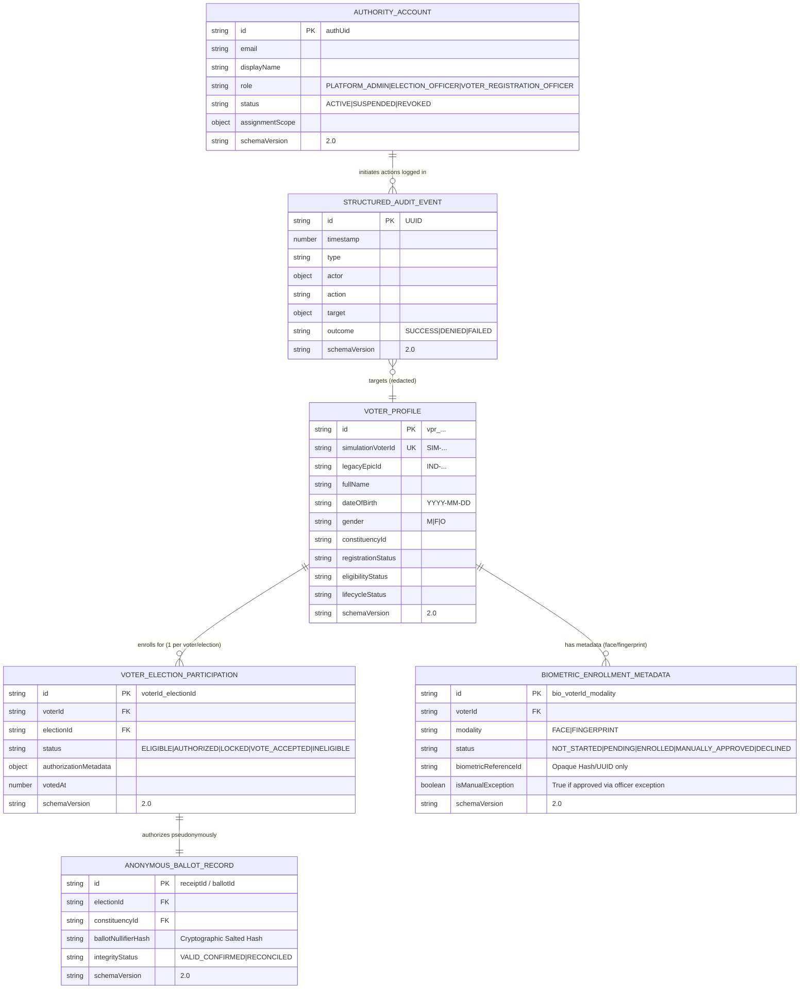
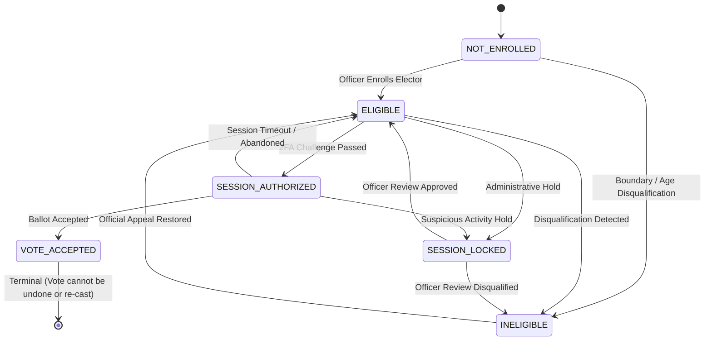

# BlockBallot — Data Model & Persistence Architecture

> **Document Status**: Established in Phase 02 (Data Model & Schema Versioning)  
> **Schema Version**: `2.0` (Active) | Legacy Transition: `1.0`  
> **Branch**: `feature/simulation-voter-registry-rbac`

---

## 1. Architectural Overview & Domain Separation

BlockBallot enforces strict domain boundaries between **Voter Identity**, **Biometric Enrollment Metadata**, **Per-Election Participation**, **Anonymous Ballot Receipts**, **Authority Accounts**, and **Security Audit History**.

---

## 2. Core Entities & Lifecycle Specifications

### A. Voter Profile (`VoterProfile`)
Represents a reusable civic simulation identity.

* **Collection**: `/voter_profiles/{id}`
* **Document Identifier**: `vpr_...` (server-generated)
* **Fields**:
  - `id`: Internal unique string.
  - `simulationVoterId`: Public simulation identifier (e.g., `SIM-DL-2026-0001`). *Generated server-side in Phase 04. Never mirrors real Indian ECI 3-letter + 7-digit format.*
  - `legacyEpicId`: Optional legacy identifier for migrated records.
  - `fullName`: Elector's legal full name.
  - `dateOfBirth`: Canonical ISO 8601 string (`YYYY-MM-DD`).
  - `gender`: `'M' | 'F' | 'O'`.
  - `state`: Elector's home state.
  - `district`: Administrative district.
  - `constituencyId`: Assigned constituency reference (e.g., `CONST-04-ND`).
  - `pollingStation`: Assigned polling booth/station.
  - `maskedMobile`: Redacted contact number (e.g., `+91 98XXX-XX341`).
  - `registrationStatus`: `'PENDING_VERIFICATION' | 'REGISTERED' | 'SUSPENDED' | 'DE_REGISTERED'`.
  - `eligibilityStatus`: `'ELIGIBLE' | 'INELIGIBLE_AGE' | 'INELIGIBLE_DISQUALIFIED' | 'INELIGIBLE_DECEASED'`.
  - `lifecycleStatus`: `'ACTIVE' | 'ARCHIVED' | 'LOCKED'`.
  - `createdAt` / `updatedAt`: Timestamps in milliseconds.
  - `createdByOfficerId` / `lastUpdatedByOfficerId`: Auditable officer references.
  - `schemaVersion`: `'2.0'`.

> **Prohibited Invariant**: Voter profiles NEVER store biometric payloads, raw images, templates, candidate choices, or transaction calldata.

---

### B. Voter Election Participation (`VoterElectionParticipation`)
Tracks an elector's independent voting status for a specific election.

* **Collection**: `/voter_election_participation/{voterId}_{electionId}`
* **Document Identifier Compound Key**: `${voterId}_${electionId}` (strictly prevents multiple records for the same voter in the same election).
* **Fields**:
  - `id`: `${voterId}_${electionId}`.
  - `voterId`: Foreign key to `VoterProfile.id`.
  - `electionId`: Foreign key to `Election.id`.
  - `status`: Explicit participation state union:
    - `NOT_ENROLLED`: Voter has not yet been evaluated for this election.
    - `ELIGIBLE`: Voter is registered and qualified for this election schedule.
    - `SESSION_AUTHORIZED`: Voter authenticated via OTP/challenge; session ticket issued.
    - `SESSION_LOCKED`: Voting session paused or under manual administrative review.
    - `VOTE_ACCEPTED`: On-chain ballot confirmed or accepted. **Terminal State.**
    - `INELIGIBLE`: Disqualified or outside constituency boundary for this election.
  - `authorizationMetadata`: `{ authorizedWallet?: string; activeNullifier?: string; ticketExpiry?: number; authorizedAt?: number }`.
  - `votedAt`: Unix timestamp when the vote was accepted.
  - `createdAt` / `updatedAt`: Timestamps in milliseconds.
  - `schemaVersion`: `'2.0'`.

#### Participation State Machine & Legal Transitions

> **Critical Invariant**: A voter who votes in **Election A** (`VOTE_ACCEPTED`) remains **completely eligible** to participate independently in **Election B**. Global `VOTED` flags are retired in favor of per-election records.

---

### C. Biometric Enrollment Metadata (`BiometricEnrollmentMetadata`)
Stores device-level enrollment metadata and quality scores without storing raw biometric bytes.

* **Collection**: `/biometric_enrollments/bio_{voterId}_{modality}`
* **Modalities**: `'FACE'` | `'FINGERPRINT'`.
* **Fields**:
  - `id`: `bio_${voterId}_${modality.toLowerCase()}`.
  - `voterId`: Foreign key to `VoterProfile.id`.
  - `modality`: `'FACE' | 'FINGERPRINT'`.
  - `status`: Explicit lifecycle state:
    - `NOT_STARTED`: No enrollment attempt.
    - `PENDING`: Enrollment in progress.
    - `ENROLLED`: Captured and validated by device/algorithm.
    - `DEVICE_UNAVAILABLE`: Scanner hardware offline or disconnected.
    - `PENDING_MANUAL_REVIEW`: Quality low; awaiting officer review.
    - `MANUALLY_APPROVED`: Approved via administrative exception.
    - `DECLINED`: Elector declined biometric capture.
    - `REQUIRES_REENROLLMENT`: Template corrupted or revoked.
  - `biometricReferenceId`: Opaque reference identifier (SHA-256 hash or UUID). **Never contains raw templates or images.**
  - `qualityScore`: 0–100 normalized quality metric.
  - `qualityCheckStatus`: `'PASSED' | 'FAILED' | 'EXEMPTED' | 'PENDING'`.
  - `isManualException`: Boolean. Explicitly `true` ONLY for `MANUALLY_APPROVED`.
  - `exceptionDecisionReference`: Official exception case ID.
  - `schemaVersion`: `'2.0'`.

> **Critical Distinction**: `MANUALLY_APPROVED` represents an administrative policy override, **NOT** a successful biometric match.

---

### D. Anonymous Ballot & Receipt Record (`AnonymousBallotRecord`)
Represents an accepted vote receipt, architecturally segregated from voter identity.

* **Collection**: `/ballots/{id}`
* **Fields**:
  - `id`: Generated receipt reference (e.g., `rcpt_...`).
  - `electionId`: Election reference.
  - `constituencyId`: Constituency reference.
  - `ballotNullifierHash`: Salted cryptographic nullifier hash (ensuring double-vote prevention without leaking voter identity).
  - `acceptedAt`: Timestamp of ballot acceptance.
  - `integrityStatus`: `'VALID_CONFIRMED' | 'RECONCILED' | 'CHALLENGED'`.
  - `blockchainReconciliation`: `{ txHash?: string; blockNumber?: number; gasUsed?: number; watermark?: string }`.
  - `schemaVersion`: `'2.0'`.

> **Prohibited Invariant**: Ballot records strictly reject `voterId`, `simulationVoterId`, `epicId`, `fullName`, `mobile`, and `biometricReferenceId`.

---

### E. Authority Account (`AuthorityAccount`)
Defines role-based access control metadata for officers and platform administrators.

* **Collection**: `/authority_accounts/{id}`
* **Operational Roles**:
  - `PLATFORM_ADMIN`: System-level administrator (e.g., local demo administrator `demo.admin@blockballot.local`).
  - `ELECTION_OFFICER`: Manages election lifecycles, schedules, and constituency candidate registries (Phase 03).
  - `VOTER_REGISTRATION_OFFICER`: Enrolls voters, reviews biometric exceptions, and manages identity verification (Phase 03).
* **Fields**:
  - `id`: Firebase Auth UID or system account ID.
  - `email`: Official authorized email address.
  - `displayName`: Officer's formal display name.
  - `role`: `AuthorityRole`.
  - `status`: `'ACTIVE' | 'SUSPENDED' | 'REVOKED'`.
  - `assignmentScope`: `{ state?: string; district?: string; constituencyIds?: string[]; electionIds?: string[] }`.
  - `schemaVersion`: `'2.0'`.

---

### F. Structured Audit Event (`StructuredAuditEvent`)
Append-only log for security observability, authentication events, and administrative decisions.

* **Collection**: `/audit_events/{id}`
* **Fields**:
  - `id`: Unique event UUID.
  - `timestamp`: Epoch milliseconds.
  - `type`: High-level event category.
  - `actor`: `{ actorId: string; actorRole: AuditActorRole; ipAddressHash?: string }`.
  - `action`: Specific action verb (e.g., `ISSUE_EIP712_TICKET`, `ENROLL_VOTER`).
  - `target`: `{ category: AuditTargetCategory; targetReference: string }`.
  - `outcome`: `'SUCCESS' | 'DENIED' | 'FAILED' | 'CHALLENGED'`.
  - `reasonCode`: Machine-readable error or exception code.
  - `metadata`: Redacted key-value pairs. **Passwords, OTPs, session tokens, and biometric bytes are strictly prohibited.**
  - `schemaVersion`: `'2.0'`.

---

## 3. Persistence Boundaries & Projection Rules

| Collection | Read Permissions | Write Permissions | Restricted Fields (Never Returned Publicly) |
| :--- | :--- | :--- | :--- |
| `voter_profiles` | Self (matching UID) or Admin/Officer | Server Admin SDK only (Client write: `false`) | `maskedMobile`, `dateOfBirth`, internal UUID |
| `voter_election_participation` | Self or Admin/Officer | Server Admin SDK only (Client write: `false`) | `activeNullifier`, private session metadata |
| `biometric_enrollments` | Strictly Server-Side (Client read: `false`) | Strictly Server-Side (Client write: `false`) | **All fields** (Internal verification only) |
| `ballots` | Public Receipt Verification | Server Admin SDK only (Client write: `false`) | None (Anonymous by design) |
| `authority_accounts` | Self or Admin | Server Admin SDK only (Client write: `false`) | Internal permissions scope |
| `audit_events` | Public / Transparency Auditor | Server Admin SDK only (Client write: `false`, immutability enforced) | IP hashes, correlation traces |
| `elections` | Public Read | Admin / Election Officer | Internal scheduling locks |
| `historical_constituencies_2024` | Public Read (Read-Only) | Client Write: `false` (Server Import Only) | None |

---

## 4. Current Implementation vs. Future Phases

| Component | Phase 02 Status (Implemented) | Target Future Phase |
| :--- | :--- | :--- |
| **Data Types & Enums** | Fully defined & runtime validated | Consumed across Phases 03–09 |
| **Repositories** | In-Memory & Firestore implementations tested | Production backend deployment |
| **Migration Inspection** | Read-only dry run & anomaly reporter | Phase 04 / Phase 09 data migration |
| **Officer Role Permissions** | Types & schema established | Phase 03 (RBAC Enforcement) |
| **Voter ID Generation** | Format defined (`SIM-...`), real ECI rejected | Phase 04 (Voter Registry API) |
| **Biometric Capture / Hardware** | Reference metadata models established | Phase 05 (Face/Fingerprint Integration) |
| **Manual Exceptions** | Metadata states established | Phase 06 (Exception Approvals) |
| **Solidity Calldata Secrecy** | Preserved with transparent calldata warning | Future cryptographic research |
