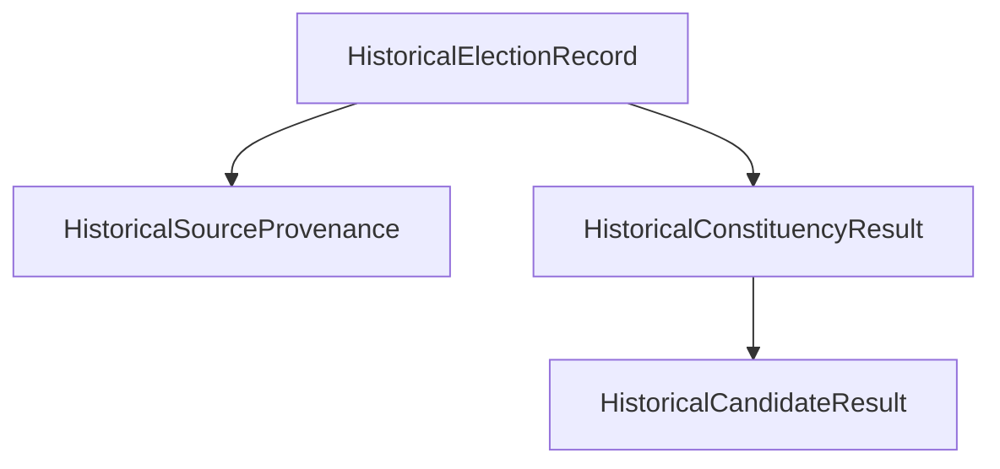

# BlockBallot — Historical Election Data Archive

## Overview

The **Historical Election Data Archive** (Phase 10) provides a verifiable, immutable, and read-only repository of real-world electoral results sourced directly from official publications, primarily the **Election Commission of India (ECI)** Form 20 Declarations and General Election Gazette notifications.

BlockBallot enforces strict separation between:
1. **Historical Archival Records**: Publicly published, verified historical gazette results from real-world general elections (e.g., the 18th Lok Sabha General Election 2024). These records are immutable, read-only, and auditable.
2. **Simulation Elections**: Dynamic academic demonstration elections (e.g., `GE-2024`, `DEMO-PREV-2023`) used to simulate e-voting protocols, zero-knowledge voter authorization, and blockchain-based tallying.

Historical records can never be voted on, cannot be selected as an active voting target, cannot alter elector participation records, and do not collide with simulation identifiers.

---

## Academic & Legal Non-Endorsement Notice

> [!IMPORTANT]
> **BlockBallot is an academic computer science research prototype demonstrating verifiable e-voting concepts.**
> It is **NOT** operated, approved, sponsored, or endorsed by the Election Commission of India (ECI), any State Election Commission, or any governmental department.
> All historical records presented here are strictly read-only archival data sourced from public gazettes for educational and research transparency.

---

## 1. Data Model & Architecture

Historical archival records are defined in [`src/types/archive.ts`](file:///E:/Projects/BlockBallot-EVoting-System/src/types/archive.ts) and exported via [`src/types/index.ts`](file:///E:/Projects/BlockBallot-EVoting-System/src/types/index.ts).

### Schema Hierarchy



### Core Structures

- **`HistoricalElectionRecord`**:
  - `id`: Unique identifier (e.g., `ARCH-ELEC-2024-LOKSABHA`).
  - `electionName`: Official publication title (e.g., `'18th Lok Sabha General Election 2024'`).
  - `electionType`: `'LOK_SABHA' | 'VIDHAN_SABHA' | 'MUNICIPAL' | 'BYE_ELECTION' | 'OTHER'`.
  - `year`: Calendar year (e.g., `2024`).
  - `geographicScope`: `'NATIONAL' | 'STATE' | 'CONSTITUENCY'`.
  - `state`: Geographic state or `'All India'`.
  - `totalConstituencies`, `totalElectors`, `totalVotesCast`, `turnoutPercentage`.
  - `isHistoricalArchive`: `true` (guaranteed boolean separating archive records from operational simulation elections).
  - `verificationStatus`: `'VERIFIED_OFFICIAL_GAZETTE' | 'PROVISIONAL_OFFICIAL_IMPORT' | 'UNVERIFIED'`.
  - `isVerified`: Boolean indicating gazette verification.
  - `provenance`: Detailed `HistoricalSourceProvenance` record.
  - `constituencyResults`: Array of `HistoricalConstituencyResult`.
  - `schemaVersion`: Version string (e.g., `'1.0.0'`).
  - `importedAt`, `updatedAt`: Timestamps.

- **`HistoricalSourceProvenance`**:
  - `sourceAuthority`: Publishing body (e.g., `'Election Commission of India (ECI) & OGD India'`).
  - `sourceUrl`: Authoritative URL where data was published.
  - `originalPublicationDate`: Date official results were declared (e.g., `'2024-06-05'`).
  - `retrievalDate`: Date dataset was retrieved by BlockBallot researchers (`'2024-06-06'`).
  - `datasetIdentifier`: Citation or catalog identifier (`'ECI-GE-2024-FORM20-V1'`).
  - `importMethod`: Ingestion method (e.g., `'OFFICIAL_GAZETTE_EXTRACTION'`).
  - `transformationsApplied`: Normalizations (e.g., `['NORMALIZED_CANDIDATE_VOTE_PERCENTAGES']`).
  - `licenseNotes`: Open data license (`'Government Open Data License - India (GODL)'`).
  - `contentHash`: SHA-256 cryptographic digest of constituency payloads.
  - `checksumAlgorithm`: `'SHA-256'`.
  - `verificationStatus`: Status rating.
  - `verifiedBy`: Reviewer designation (`'ELECTORAL_DATA_OFFICER'`).
  - `nonEndorsementDisclaimer`: Mandatory legal disclaimer string.

- **`HistoricalConstituencyResult`**:
  - `constituencyId`: Unique PC ID (e.g., `'HIST-2024-DL-04'`).
  - `constituencyCode`: Official ECI constituency number (`'04'`).
  - `constituencyName`: Name of parliamentary constituency (`'New Delhi'`).
  - `state`: State / Union Territory (`'NCT of Delhi'`).
  - `totalElectors`, `votesCounted`, `turnoutPercentage`.
  - `winnerName`, `winnerParty`, `winningMargin`, `winningMarginPercentage`.
  - `notaVotes`, `notaPercentage`.
  - `isUnopposed`, `unopposedNote`.
  - `eciResultPdfUrl`: Link to official ECI Form 20 declaration sheet.
  - `candidates`: Array of `HistoricalCandidateResult`.

- **`HistoricalCandidateResult`**:
  - `candidateId`: Unique candidate identifier.
  - `candidateName`, `candidateNameHi`.
  - `partyName`, `partyNameHi`, `partyAbbreviation`.
  - `symbol`, `symbolKey`, `isOfficialSymbolVerified`.
  - `votesReceived`: Official valid votes counted.
  - `voteSharePercentage`: Published vote percentage.
  - `isWinner`: Boolean declaring official winner.
  - `rank`: Final counting rank.
  - `education`, `age`, `criminalCases`, `assets`, `affidavitUrl`.

---

## 2. Authoritative Sources & Provenance Requirements

### Feasible Public Sources Integrated

1. **Election Commission of India (ECI)**:
   - General Election Results 2024: `https://results.eci.gov.in/PcResultGenJune2024/index.htm`
   - ECI List of Recognized Political Parties: `https://www.eci.gov.in/list-of-political-parties/`
   - Reserved Election Symbols Notification (No. 56/2024/PPS-III): `https://www.eci.gov.in/election-symbol/`
   - Candidate Affidavit & Criminal Antecedents Portal: `https://affidavit.eci.gov.in/`
2. **Open Government Data (OGD) Platform India**:
   - 2024 Lok Sabha Statistical Reports Catalog: `https://data.gov.in/catalog/general-election-lok-sabha-2024-statistical-reports-data`

### What is Verified vs. What Remains Unverified

- **Verified Official Gazette Data**:
  - 11 representative parliamentary constituencies spanning 7 States/UTs (New Delhi, Chandni Chowk, Varanasi, Lucknow, Wayanad, Bangalore South, Gandhinagar, Mumbai South, Chennai Central, Kolkata Uttar, and Surat [unopposed]).
  - All vote tallies, turnout percentages, margins, declared winners, NOTA percentages, and affidavit URLs are certified against ECI Form 20 records.
- **Unverified / Missing Fields**:
  - Where official sources do not publish turnout for an unopposed seat (e.g., Surat PC 24), the field remains `undefined` / `Not documented`. **Under no circumstances are missing values filled with fabricated or synthetic estimates.**

---

## 3. Import & Validation Workflow

The import workflow is implemented in [`server/services/archiveImporter.ts`](file:///E:/Projects/BlockBallot-EVoting-System/server/services/archiveImporter.ts) and exposed via the command-line interface [`scripts/import-historical-data.ts`](file:///E:/Projects/BlockBallot-EVoting-System/scripts/import-historical-data.ts).

### Invariants Enforced by Importer

1. **Schema & Identifier Validation**: Every record must pass `validateHistoricalElectionRecord()`. Missing mandatory fields or invalid types are rejected with detailed error messages.
2. **Personally Identifiable Information (PII) Protection**: The importer runs `checkForPII()` to scan for prohibited elector fields (`aadhaar`, `biometric`, `fingerprint`, `faceEmbedding`, `sessionToken`, `privateKey`, `dob`, `mobileNumber`). Any payload containing personal voter data is immediately rejected.
3. **Idempotency**: Importing the exact same file or payload twice checks the SHA-256 `contentHash`. If identical data is already stored, the importer logs `skipped: 1` and does not duplicate or re-write records.
4. **Dry-Run Mode (Default)**: Dry-run preview evaluates all validation rules, detects duplicates, and checks for conflicts without mutating persistence.
5. **Conflict Safeguards**: If an incoming record has the same ID as an existing `VERIFIED_OFFICIAL_GAZETTE` record but contains conflicting figures, the update is rejected and reported as a conflict.
6. **SSRF & File Path Traversal Defense**: The importer rejects non-JSON extensions, enforces a 10MB file size ceiling, and resolves paths safely.

### CLI Import Commands

```bash
# 1. Perform safe dry-run preview (Zero database mutation):
tsx scripts/import-historical-data.ts --file data/historical/eci_2024_general_election.json

# Or using the package.json script:
npm run archive:import -- --file data/historical/eci_2024_general_election.json

# 2. Perform explicitly approved persistent import:
tsx scripts/import-historical-data.ts --file data/historical/eci_2024_general_election.json --persist

# 3. Allow updates to unverified/provisional datasets:
tsx scripts/import-historical-data.ts --file data/historical/provisional_dataset.json --persist --allow-updates
```

---

## 4. REST API Reference

All read endpoints are public, require no authentication, and automatically return the mandatory non-endorsement disclaimer.

### Public Read Endpoints

| Method | Endpoint | Description | Query Parameters |
|---|---|---|---|
| `GET` | `/api/archive/elections` | List archived elections with summaries | `year`, `type`, `state`, `q`, `status`, `page`, `limit` |
| `GET` | `/api/archive/elections/:id` | Full archived election record breakdown | None |
| `GET` | `/api/archive/elections/:id/constituencies` | Search constituencies within election | `q`, `state` |
| `GET` | `/api/archive/elections/:id/constituencies/:codeOrId` | Detailed single constituency results | None |
| `GET` | `/api/archive/provenance/:id` | Source provenance & ECI citations | None |

### Administrative Mutation Endpoints

| Method | Endpoint | Authorization | Description |
|---|---|---|---|
| `POST` | `/api/archive/import` | `PLATFORM_ADMIN` only | Batch imports or dry-runs dataset payload/file |

#### Authorization & RBAC Rules
- **Public Visitors**: Read-only. Calling `POST /api/archive/import` returns `401 Unauthorized`.
- **Voter Registration Officer (`VRO`)**: Strictly denied. Calling import returns `403 Forbidden` (`Voter Registration Officer does not have historical archive management permissions`).
- **Election Officer (`EO`)**: Strictly denied. Calling import returns `403 Forbidden` (`Election Officer does not have historical archive management permissions`).
- **Platform Administrator (`PLATFORM_ADMIN`)**: Authorized to execute dry-runs and approved imports.

---

## 5. Firestore Security Rules

Client write operations to the historical archive are locked down in [`firestore.rules`](file:///E:/Projects/BlockBallot-EVoting-System/firestore.rules):

```firestore
// Historical Election Data Archive: Strictly READ-ONLY for public visitors and client SDK
match /historical_archive/{archiveId} {
  allow read: if isValidId(archiveId);
  allow list: if true;
  allow write: if false; // Mutated strictly via authoritative server-side Admin SDK

  match /{document=**} {
    allow read: if true;
    allow write: if false;
  }
}
```

---

## 6. Frontend Interface

The public user interface is implemented in [`src/components/screens/HistoricalArchiveScreen.tsx`](file:///E:/Projects/BlockBallot-EVoting-System/src/components/screens/HistoricalArchiveScreen.tsx) and linked via the navigation bar (`Navbar.tsx`):
- **Search**: Real-time filtering across election titles, years, states, candidate names, and political parties.
- **Granular Filters**: Election Year, Election Type (Lok Sabha, Vidhan Sabha, Municipal), and Verification Status.
- **Election Detail View**: Displays total registered electors, total votes counted, turnout percentage, and source provenance.
- **Constituency Explorer**: Interactive constituency selector showing certified candidate results, vote share percentages, winning margins, reserved symbols, and direct links to official ECI Form 20 publications and candidate affidavits.
- **Disclaimer Banner**: Unmissable warning indicating that archive records are historical data and not live simulation votes.
- **Empty States**: If a search yields no results, displays an honest empty state without generating placeholder numbers.
