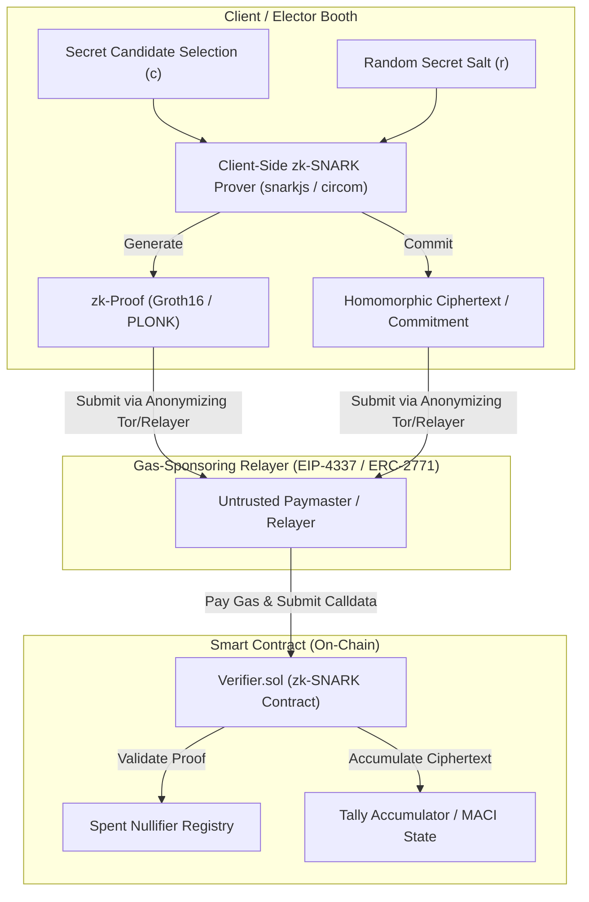

# BlockBallot — Comprehensive Known Limitations & Cryptographic Defect Catalog

**Document ID**: `DOC-BB-PH13-LIMITS-001`  
**Target Repository**: `rudradave12/blockballot-e-voting-system`  
**Baseline Branch**: `feature/simulation-voter-registry-rbac`  
**Baseline Commit**: `340def9` (`feat(ui): integrate responsive and accessible BlockBallot experience`)  
**Evaluation Standard**: Academic Simulation & Security Verification (Strictly non-certified for legally binding public elections)  
**Date**: October 2026  

---

## 1. Executive Summary & Purpose

This document provides a rigorous, transparent, and exhaustive catalog of the architectural, cryptographic, hardware, and operational limitations identified in the **BlockBallot E-Voting System** at the completion of Phase 13.

BlockBallot was designed as an advanced academic prototype to demonstrate decentralized state verification, EIP-712 structured voting authorization, single-use nullifiers, field-level AES-256-GCM encryption, role-based electoral administration, and public election monitoring. 

**This catalog serves as an uncompromised disclosure: BlockBallot contains known cryptographic and environmental constraints that make it unsuitable and non-compliant for legally binding public elections.**

```
┌────────────────────────────────────────────────────────────────────────────────────────┐
│                              TAXONOMY OF KNOWN LIMITATIONS                            │
├──────────────────────────┬─────────────────────────────────────────────────────────────┤
│ Limitation Domain        │ Specific Technical Vulnerability or Boundary               │
├──────────────────────────┼─────────────────────────────────────────────────────────────┤
│ 1. Cryptography / EVM    │ BB-SEC-PH09-BALLOT-SECRECY: Plaintext Calldata & Event Leak │
│ 2. Cryptography / EVM    │ Voter Wallet Address Linkability (`msg.sender` in Events)   │
│ 3. Cryptography / EVM    │ Real-Time On-Chain Vote Counting (Pre-Tally Information)   │
│ 4. Identity & Biometrics │ WebCam & Simulated Scanner vs STQC-Certified Hardware       │
│ 5. Identity & Biometrics │ Synthetic Demographic Registry vs Live ECI/UIDAI Databases  │
│ 6. Session Containment   │ Browser Fullscreen Heuristic vs Operating System Kiosk      │
│ 7. Scalability & State   │ Single-Node In-Memory Rate Limiting vs Distributed Cache    │
│ 8. Ledger Throughput     │ Base EVM Gas / Block Time vs National Scale (900M+ Electors)│
│ 9. Historical Archive    │ Curated 2024 Reference Set vs Comprehensive National Archive│
└──────────────────────────┴─────────────────────────────────────────────────────────────┘
```

---

## 2. Cryptographic Defect Deep-Dive: Ballot Secrecy & On-Chain Transparency

### 2.1 The Core Vulnerability (`BB-SEC-PH09-BALLOT-SECRECY`)
* **Component**: `contracts/IndianElection.sol`
* **Severity**: **CRITICAL (Production Blocker)**
* **CWE Classification**: CWE-200 (Information Exposure) / CWE-359 (Exposure of Private Personal Data)

In `IndianElection.sol`, the vote recording function is declared as follows:
```solidity
function castVote(
    uint256 _electionId,
    uint256 _constituencyId,
    uint256 _candidateId,
    bytes32 _nullifier,
    uint256 _expiry,
    bytes calldata _signature
) external {
    // ... verification logic ...
    candidates[_electionId][_constituencyId][_candidateId].voteCount += 1;
    spentNullifiers[_nullifier] = true;
    hasVotedInElection[_electionId][msg.sender] = true;

    emit VoteCast(_electionId, _constituencyId, _candidateId, _nullifier, msg.sender);
}
```

This implementation contains four distinct cryptographic flaws:

#### 1. Plaintext Calldata Transmission
The argument `uint256 _candidateId` is transmitted in cleartext within the transaction calldata:
```
Function Selector: 0x5a19286d
Parameter [0] (_electionId):     0000000000000000000000000000000000000000000000000000000000000001
Parameter [1] (_constituencyId): 0000000000000000000000000000000000000000000000000000000000000004
Parameter [2] (_candidateId):    0000000000000000000000000000000000000000000000000000000000000002 <-- EXPOSED
Parameter [3] (_nullifier):      e3b0c44298fc1c149afbf4c8996fb92427ae41e4649b934ca495991b7852b855
...
```
Any mempool observer, miner, validator, or node operator can extract the voter's candidate selection before the transaction is even mined into a block.

#### 2. Public Event Topic Emission
The smart contract emits the `VoteCast` event where `_candidateId` is an indexed topic:
```solidity
event VoteCast(
    uint256 indexed electionId,
    uint256 indexed constituencyId,
    uint256 indexed candidateId,    // <--- TOPIC #3: Searchable in Bloom filter
    bytes32 nullifier,
    address voterWallet             // <--- Disclosed voter wallet address
);
```
Anyone querying an Ethereum JSON-RPC endpoint (`eth_getLogs`) can query exactly which wallet cast a vote for which candidate.

#### 3. Direct Voter Wallet Linkability
Because `castVote` is called directly by the voter's Web3 wallet (`msg.sender`), the transaction is permanently signed by `voterWallet`. If an adversary links the voter's wallet to their IP address, browser fingerprint, or exchange account, the voter's political franchise is completely de-anonymized.

#### 4. Real-Time On-Chain Tally Leakage
The contract immediately increments `candidates[...].voteCount += 1`. This allows anyone to monitor voting trends while polling is open, which violates election integrity guidelines against exit polling and real-time tally leakage during voting hours.

---

### 2.2 Why Naive Cryptographic Fixes Fail

During audit and development, various simplistic remediations were analyzed and rejected as cryptographically unsound:

1. **Client-Side Hashing (`keccak256(candidateId)`)**:
   * *Flaw*: An election in a constituency has a small candidate space (typically 2 to 20 candidates). An attacker simply hashes each candidate ID (`keccak256(1)`, `keccak256(2)`, etc.) and compares it to the submitted hash. Inversion takes microseconds.
2. **Symmetric AES Encryption with Server Key**:
   * *Flaw*: Encrypting the ballot with a server-held AES key creates a centralized point of failure. The server operator can decrypt all ballots, enabling coercion, extortion, or insider leaks.
3. **Obfuscation / Dynamic Candidate Shuffling**:
   * *Flaw*: Security through obscurity fails in decentralized protocols. If the mapping is public, the choice is public; if the mapping is private to the server, the server can tamper with or deanonymize votes.

---

### 2.3 Required Production Architecture: Zero-Knowledge & Anonymizing Relayers

To achieve true, uncompromised ballot secrecy suitable for a production election, the following standardized cryptographic schemes must be introduced:



1. **zk-SNARK Ballot Verification (Groth16 / PLONK)**:
   * The elector generates a zero-knowledge proof locally in their browser.
   * The proof asserts: *"I hold a valid EIP-712 authorization ticket signed by the Election Authority for election $E$ and constituency $C$, my candidate choice $c$ is within the valid candidate set $[1 \dots N]$, and the nullifier $H(\text{identity}, \text{salt})$ has not been spent"*, **without revealing $c$ or the voter's identity**.
2. **Minimum Anti-Collusion Infrastructure (MACI)**:
   * Electors submit encrypted ballots to an on-chain queue using an asymmetric coordinator public key.
   * Electors can change their voting key at any time, neutralizing vote-buying and extortion.
   * At election close, an isolated coordinator decrypts the encrypted ballots off-chain and generates a zk-SNARK proof of the final aggregate tally, proving correctness without ever disclosing individual selections.
3. **Decoupled Relayers (ERC-4337 / ERC-2771)**:
   * The voter never submits a transaction directly from their personal Ethereum wallet. An untrusted relayer or account-abstraction paymaster submits the calldata and covers gas fees, breaking the network-layer linkage between the voter's IP/wallet and the submitted nullifier.

---

## 3. Biometric & Identity Hardware Limitations

### 3.1 Simulated Biometric Capture vs STQC Certified Scanners
* **Current Implementation**:
  - WebCam facial enrollment and verification capture standard 2D frames via the browser's `navigator.mediaDevices.getUserMedia` API.
  - Fingerprint enrollment utilizes a software device adapter (`PhysicalScannerSdkAdapter` / `mock-fingerprint-preview`) that simulates minutiae extraction.
* **Limitations**:
  - **No Hardware Cryptographic Attestation**: Real-world biometric authentication in government elections requires STQC-certified (Standardisation Testing and Quality Certification) Level 0 or Level 1 Registered Devices (RD).
  - **Liveness Detection Vulnerability**: Standard 2D webcams are susceptible to presentation attacks (photos, video playback, 3D masks). STQC devices mandate infrared (IR) multi-spectral imaging or structured light depth sensors.
  - **Non-Standard Biometric Formats**: The prototype extracts synthetic hash vectors rather than certified ISO/IEC 19794-2 (fingerprint minutiae) or ISO/IEC 19794-5 (facial biometric data) interchange records.

### 3.2 Synthetic Voter Registry vs National Identity Systems
* **Current Implementation**:
  - Demographic records use synthetic EPIC IDs (`IND-DL-982341`, `BBV-SIM-...`) stored in Firestore and the backend cache.
* **Limitations**:
  - The system does not interface with the Election Commission of India (ECI) ERMS (Electoral Roll Management System) or UIDAI Aadhaar e-KYC API.
  - Live national integration would require dedicated government-approved leased lines, hardware security modules (HSM), and compliance with the Aadhaar Act, 2016.

---

## 4. Session Containment & Kiosk Security Limitations

### 4.1 Browser Fullscreen Heuristic vs Operating System Kiosk
* **Current Implementation**:
  - `VotingBoothModal.tsx` and `server/store.ts` enforce a 3-strike fullscreen exit policy. When the user exits fullscreen or defocuses the browser window, an exit event is logged. On the 3rd exit, the session transitions to `LOCKED_SUPERVISED_RECOVERY`.
* **Limitations**:
  - **OS-Level Bypasses**: Standard web browsers cannot intercept all operating system key combinations (e.g., `Ctrl+Alt+Del` on Windows, `Cmd+Option+Esc` on macOS, or hardware volume/power buttons on mobile devices).
  - **Multi-Monitor Bypasses**: On multi-monitor workstations, moving the mouse to a secondary display may not consistently trigger `fullscreenchange` if the browser retains focus.
  - **Browser Extension Interference**: Malicious browser extensions or accessibility overlays can inject scripts or capture screen contents without triggering DOM blur events.
* **Production Requirement**:
  - Physical polling station voting machines require a stripped-down, hardened Linux OS running a read-only kiosk shell with all USB ports, keyboards, and network interfaces physically or cryptographically locked.

---

## 5. Scalability, Concurrency & Infrastructure Limitations

### 5.1 Single-Node In-Memory Rate Limiting
* **Current Implementation**:
  - Global API rate limiting and per-EPIC lookup cooldowns are maintained in Node.js process memory (`server/store.ts`).
* **Limitations**:
  - If the backend is scaled horizontally across multiple instances (e.g., behind a Kubernetes ingress or load balancer), in-memory rate limits are not shared across nodes. An attacker could rotate requests across nodes to bypass lockout thresholds.
  - Server restarts clear active in-memory cooldown counters (though persistent session states in Firestore survive).
* **Production Requirement**:
  - Production deployments must use a distributed, high-availability in-memory cache such as Redis or Google Cloud Memorystore with atomic sliding-window rate limit scripts.

### 5.2 Blockchain Throughput & Gas Economics
* **Current Implementation**:
  - The prototype executes on Hardhat local testnet with zero transaction fees and instant block mining.
* **Limitations**:
  - **Throughput Bounds**: Ethereum Layer 1 processes ~15 to 30 transactions per second (TPS). In an Indian General Election with over 968 million registered electors and peak voting volumes exceeding 50,000 votes per second, Ethereum L1 would experience catastrophic congestion and multi-million-dollar gas costs.
  - **Chain Finality Delays**: Proof-of-Stake finality takes approximately 12–15 minutes (2 epochs).
* **Production Requirement**:
  - A production sovereign election network requires an ultra-high-throughput dedicated app-chain or modular zk-Rollup capable of 100,000+ TPS with zero gas fees charged to electors.

---

## 6. Historical Election Archive Limitations

### 6.1 Sample Reference Scope
* **Current Implementation**:
  - `server/data/historicalArchive.ts` contains verified reference data for 4 sample Lok Sabha 2024 constituencies (New Delhi, Varanasi, Wayanad, Bangalore South), including official ECI candidate lists, party symbols, and turnout figures.
* **Limitations**:
  - The dataset is a curated demonstration sample. It does not contain all 543 parliamentary constituencies or the 4,120+ state legislative assembly constituencies of India.
  - Storage of full national granular polling booth data (over 1 million polling stations) requires an enterprise data lakehouse (e.g., BigQuery / Apache Iceberg) rather than local static JSON datasets.

---

## 7. Summary & Future Roadmap

| Milestone | Target Capability | Required Technologies |
| :--- | :--- | :--- |
| **Phase 14 (Research)** | Zero-Knowledge Anonymous Ballots | Circom / SnarkJS, Groth16 Verifier Contract |
| **Phase 15 (Research)** | Anti-Collusion & Coercion Resistance | MACI (Minimum Anti-Collusion Infrastructure) |
| **Phase 16 (Hardware)**| STQC Certified Biometric Devices | Android/Linux RD Service Native Daemon |
| **Phase 17 (Network)** | Gas-Sponsored Relayer Network | ERC-4337 Account Abstraction Paymaster |
| **Phase 18 (Scale)**   | High-Throughput Sovereign zk-Rollup | Sovereign App-Chain / Polygon CDK / Arbitrum Orbit |

---

**Certified by**: BlockBallot Lead Security Auditor & Architecture Pair  
**Repository**: `rudradave12/blockballot-e-voting-system`  
**Branch**: `feature/simulation-voter-registry-rbac`
