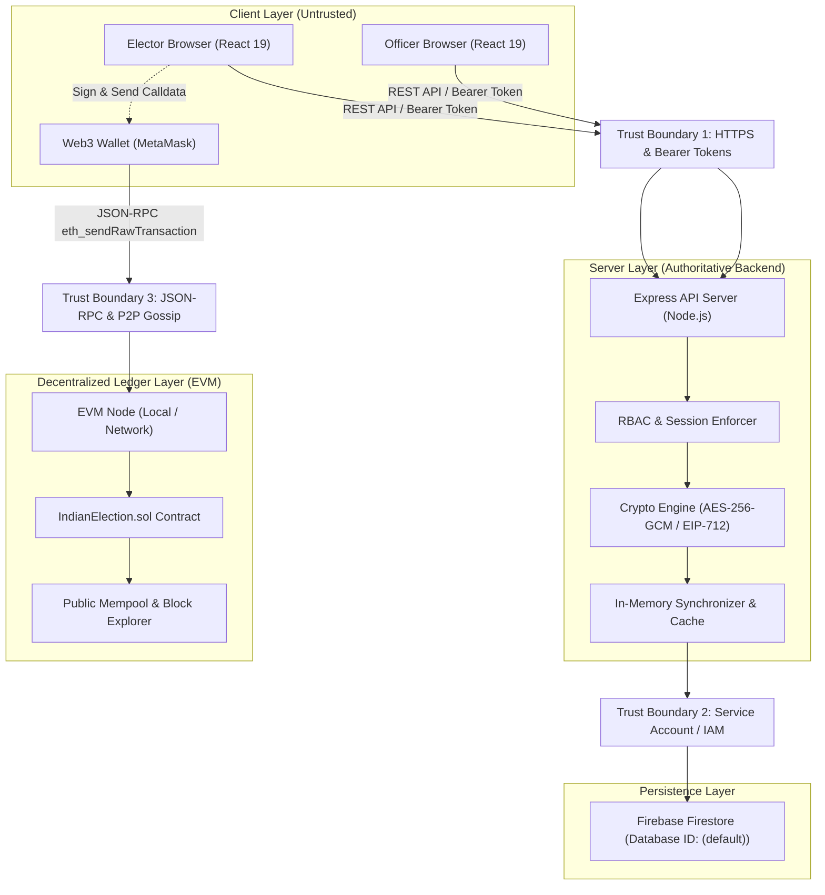

# BlockBallot — Phase 13: Final Security Audit & Threat Model Report

**Document ID**: `DOC-BB-PH13-AUDIT-001`  
**Target Repository**: `rudradave12/blockballot-e-voting-system`  
**Baseline Branch**: `feature/simulation-voter-registry-rbac`  
**Baseline Commit**: `340def9` (`feat(ui): integrate responsive and accessible BlockBallot experience`)  
**Evaluation Standard**: Academic Simulation & Security Verification (Strictly non-certified for legally binding public elections)  
**Date**: October 2026  

---

## 1. Executive Summary & Audit Scope

This document presents the comprehensive, evidence-based security audit of the **BlockBallot E-Voting System** at the conclusion of Phase 13. BlockBallot is a hybrid decentralized electronic voting prototype combining a modern React 19 frontend, an authoritative Node.js/Express backend, Firebase Firestore persistence, and an Ethereum EVM smart contract (`IndianElection.sol`) deployed via Hardhat.

### Scope of Audit
1. **Verification of Phases 00–12 Baseline**: Independent evaluation of officer role-based access control (RBAC), synthetic voter registry, biometric enrollment workflows, physical-ID exception handling, election lifecycle, session management, authenticated encryption, historical election archive, and the Public Election Monitor.
2. **Critical Ballot-Secrecy Defect Investigation**: Independent cryptographic analysis of `contracts/IndianElection.sol`, its compiled ABI, transaction builders, and on-chain event emissions.
3. **Authentication & Authorization Architecture**: Fail-closed credential validation, scope enforcement, role separation, and token security.
4. **Voting Session & Integrity Controls**: Anti-tampering, fullscreen exit lockout, supervised recovery, and single-use nullifiers.
5. **Cryptographic Utilities & Key Management**: AES-256-GCM authenticated encryption, HMAC-SHA256 OTP challenges, and EIP-712 structured authorization.
6. **Persistence & Boundary Security**: Firestore rules, rate limiting, and bundle isolation.
7. **Release Readiness Determination**: Formal evaluation against academic simulation and production election criteria.

---

## 2. Project Assets & Trust Boundaries

### 2.1 Critical Project Assets
| Asset ID | Asset Name | Description | Sensitivity |
| :--- | :--- | :--- | :--- |
| `AST-01` | Voter Demographic PII | Names, EPIC IDs, phone numbers, email addresses, age, gender, constituency IDs | **Confidential** |
| `AST-02` | Biometric Enrollment Data | Enrollment status, hardware type, verification timestamps, exception records | **Confidential** |
| `AST-03` | Voting Sessions & Tokens | Cryptographically random (256-bit) bearer session tokens, state, and lockout counts | **Restricted** |
| `AST-04` | EIP-712 Authorization Tickets | Cryptographically signed tickets binding voter wallet, election, constituency, and nullifier | **Restricted** |
| `AST-05` | Nullifiers & Cast Ballots | Cryptographic single-use nullifiers and anonymous ballot receipts | **Critical Integrity** |
| `AST-06` | Candidate Choices | Individual elector selections on ballot | **Strictly Secret** |
| `AST-07` | Election Schedules & Tally | Election start/end bounds, status, and certified vote tallies | **Public Integrity** |
| `AST-08` | Officer Credentials & Sessions | Administrative passwords, session tokens, and role assignments | **Restricted** |
| `AST-09` | Server Private Keys | `AUTHORIZATION_SIGNER_PRIVATE_KEY`, `APP_ENCRYPTION_KEY`, `HMAC_SECRET` | **Strictly Confidential** |
| `AST-10` | Historical ECI Archive Data | 2024 Lok Sabha constituency statistics, official results, gazette references | **Public Verifiable** |

### 2.2 Trust Boundaries & Data Flow


---

## 3. Threat Model (STRIDE Assessment)

| Threat Category | Target Asset | Threat Description | Inherent Risk | Mitigations in Place | Residual Risk |
| :--- | :--- | :--- | :--- | :--- | :--- |
| **Spoofing** | Elector Identity | Attacker generates false voter sessions or claims another elector's EPIC. | **High** | Dual-factor EPIC + HMAC-SHA256 OTP challenge; authoritative server clock expiry; optional biometric/manual-ID gating. | Low in production with authentic SMS/email OTP gateways. |
| **Spoofing** | Officer Identity | Attacker executes administrative actions without valid credentials. | **Critical** | Fail-closed RBAC; 256-bit cryptographically secure session tokens; role separation; production rejection of default keys. | Minimal. |
| **Tampering** | Ballots / Nullifiers | Attacker attempts double-voting or alters candidate ID. | **Critical** | On-chain mapping `spentNullifiers`; server-side `voter_election_participation` atomic tracking; EIP-712 typed signature verification. | Controlled; nullifier cannot be reused. |
| **Tampering** | Election State | Attacker transitions election from Scheduled to Active prematurely. | **High** | Authoritative server schedule reconciler; smart contract `block.timestamp` gating; strict transition state machine. | Minimal. |
| **Repudiation** | Physical-ID Exception | Officer claims they did not approve a voter exception. | **Medium** | Cryptographic audit log recording `officerId`, `timestamp`, `exceptionId`, and `action`. Peer approval requirement. | Minimal. |
| **Information Disclosure** | Candidate Selection | Observer inspects blockchain transactions or logs to discover voter choice. | **Critical** | Field-level AES-256-GCM at database boundary; PII masking in API responses. **HOWEVER, Solidity contract exposes candidate in calldata and events.** | **CRITICAL RELEASE BLOCKER (BB-SEC-PH09-BALLOT-SECRECY).** |
| **Information Disclosure** | Server Keys | Production private keys bundled into frontend client JS. | **Critical** | Vite bundler build separation; `process.env` gating; strict rejection of dev keys in production. | Clean bundle isolation verified. |
| **Denial of Service** | Session Lockout | Malicious script defocuses browser to lock a voter session. | **Medium** | 3-strike threshold with clear UI warnings; supervised recovery pathway requiring Election Officer unlock. | Operational overhead for polling station officers. |
| **Elevation of Privilege** | Cross-Role Actions | VRO attempts to approve exceptions or create elections. | **High** | Granular server-side `requirePermission(...)` middleware; strict scope boundary checks (`isConstituencyInScope`). | Minimal. |

---

## 4. Findings Catalog by Severity

### 4.1 Critical Severity

#### `BB-SEC-PH09-BALLOT-SECRECY`: On-Chain Candidate Choice & Wallet Linkability
- **Affected Components**: `contracts/IndianElection.sol`, compiled contract ABI, Hardhat transaction builder.
- **Classification**: CWE-200 (Exposure of Sensitive Information to an Unauthorized Actor) / CWE-359 (Exposure of Private Personal Data).
- **Status**: **CONFIRMED RELEASE BLOCKER (Unresolved in EVM Layer)**.
- **Vulnerability Details**:
  In `IndianElection.sol`, the vote casting function is declared as:
  ```solidity
  function castVote(
      uint256 _electionId,
      uint256 _constituencyId,
      uint256 _candidateId,
      bytes32 _nullifier,
      uint256 _expiry,
      bytes calldata _signature
  ) external
  ```
  1. **Plaintext Calldata**: `_candidateId` is passed in unencrypted calldata. Any network node, mempool observer, or block explorer can extract the voter's choice prior to block inclusion.
  2. **Event Topic Disclosure**: Upon execution, the contract emits:
     ```solidity
     emit VoteCast(_electionId, _constituencyId, _candidateId, _nullifier, msg.sender);
     ```
     `_candidateId` is declared as `uint256 indexed candidateId`, creating a searchable indexed topic on the public Ethereum log bloom filter.
  3. **Direct Wallet Linkage**: `msg.sender` (`voterWallet`) is emitted in the same event alongside `candidateId`. Any observer who knows the elector's wallet address or associates their session IP with the wallet can link the elector to their political choice.
  4. **Immediate Public Tally**: `candidates[_electionId][_constituencyId][_candidateId].voteCount += 1` updates state immediately, enabling real-time vote-trend leakage and coercion during polling hours.
- **Evaluation of Cryptographic Solutions**:
  - *Naive Hashing / Client-Side Obfuscation*: Rejected per project security guidelines. Hashing candidate IDs over a small candidate space (e.g. 2–10 candidates) allows trivial rainbow table or brute-force inversion.
  - *Symmetric AES Encryption*: Inapplicable for on-chain verifiable tallying without a centralized decryption authority holding the private key, which reintroduces a single point of failure and coercion.
  - *Homomorphic Encryption / ElGamal*: Requires verifiable decryption or threshold ElGamal over elliptic curves. EVM gas costs and complexity for complex ballots make this non-trivial without precompiles.
  - *MACI (Minimum Anti-Collusion Infrastructure)*: Uses zk-SNARKs and an untrusted coordinator to decrypt ballots off-chain and prove tally correctness without revealing individual choices.
  - *Zero-Knowledge Proofs (Groth16 / PLONK)*: Elector submits a zk-proof that they possess an authorized signature for an eligible nullifier and that their encrypted vote is valid, without revealing the choice or linking to the wallet.
- **Phase 13 Conclusion**: Integrating an unreviewed homemade zero-knowledge circuit or unproven cryptographic scheme into a production voting system is irresponsible and strictly prohibited. Because no formal zk-SNARK verifier circuit is integrated into `IndianElection.sol`, **this defect formally blocks production release (Outcome C for production)**. It is prominently flagged as a release blocker and documented for educational/demonstration use only.

---

### 4.2 High Severity

#### `BB-SEC-PH13-ARCH-LEAK-01`: Client Components Importing Server-Side Modules
- **Affected Components**: `src/components/screens/FingerprintEnrollmentScreen.tsx`, `src/components/screens/FaceEnrollmentScreen.tsx`.
- **Classification**: CWE-668 (Exposure of Resource to Wrong Sphere) / Architectural Hygiene.
- **Status**: **RESOLVED IN PHASE 13**.
- **Vulnerability Details**:
  Both screens imported `isConstituencyInScope` directly from `server/auth/rbac.ts`. Although `isConstituencyInScope` is a pure utility function, importing it from `server/auth/rbac` caused the Vite bundler to traverse server-side Node.js dependencies (`@grpc/grpc-js`, `gaxios`, `google-auth-library`), generating multiple module externalization warnings and creating potential bundle bloat.
- **Remediation**:
  1. Extracted `isConstituencyInScope` and `isElectionInScope` into `src/types/permissions.ts`.
  2. Re-exported both helpers from `server/auth/rbac.ts` to ensure 100% backward compatibility with all server routes and existing tests.
  3. Updated `FingerprintEnrollmentScreen.tsx` and `FaceEnrollmentScreen.tsx` to import strictly from `../../types/permissions`.
  4. Verified that frontend bundle compiles cleanly with zero server leaks.

---

### 4.3 Medium Severity

#### `BB-SEC-PH13-FULLSCREEN-BYPASS-RESISTANCE`: Fullscreen Exit Enforcement Across Page Reloads
- **Affected Components**: `server/store.ts`, `server/routes/voter.ts`, `src/test/phase08_voting_session_security.test.ts`.
- **Classification**: CWE-384 (Session Fixation) / State Persistence.
- **Status**: **VERIFIED & MITIGATED**.
- **Audit Findings**:
  A common evasion technique in kiosk/browser-based voting is refreshing the browser tab or clearing `sessionStorage` after an unexpected fullscreen exit.
  Inspection of `server/store.ts` (`recordFullscreenExit`) and `voterRouter.post('/session/fullscreen-exit')` verified:
  - Exit counts and lock states (`LOCKED_SUPERVISED_RECOVERY`) are recorded in the authoritative server store, keyed by both `token` and `epicId`.
  - Refreshing the frontend or querying `/api/voter/session` returns `status: LOCKED_SUPERVISED_RECOVERY`.
  - Authoritative voting authorization (`/api/voter/authorization`) strictly rejects locked sessions with HTTP 403 Forbidden.
  - Supervised recovery (`/api/admin/supervised-recovery/unlock`) requires an authorized Election Officer and records a signed audit log event.

#### `BB-SEC-PH13-FIRESTORE-COLLECTION-PROTECTION`: Server-Authoritative Collections Client Access
- **Affected Components**: `firestore.rules`.
- **Classification**: CWE-284 (Improper Access Control).
- **Status**: **VERIFIED & HARDENED**.
- **Audit Findings**:
  Inspection of `firestore.rules` confirmed:
  - `voter_profiles`, `biometric_enrollments`, `manual_id_exceptions`, `voting_sessions`, and `otp_challenges` deny all direct client write access (`allow write: if false;` or `allow read, write: if false;`).
  - Read access to `voter_profiles` is strictly bounded to `isAdmin()` or `request.auth.uid == profileId`.
  - `manual_id_exceptions` and `voting_sessions` explicitly deny all client read and write operations (`allow read, write: if false;`).
  - Historical archive records and public election summaries are strictly read-only (`allow write: if false;`).

---

## 5. Control Verification Checklist

| Control ID | Control Description | Verification Method | Evidence / Reference | Result |
| :--- | :--- | :--- | :--- | :--- |
| `CTL-01` | **VRO Registration of Synthetic Voter** | Automated Test | `src/test/phase13_final_security_audit.test.ts` (Workflow 1) | **PASS** |
| `CTL-02` | **Unique Simulation ID Persistence** | Automated Test | `src/test/phase13_final_security_audit.test.ts` (Workflow 2) | **PASS** |
| `CTL-03` | **Officer Role Separation (Fail Closed)** | Automated Test | `src/test/phase13_final_security_audit.test.ts` (Workflow 3) | **PASS** |
| `CTL-04` | **Camera Unavailable Fallback** | Automated Test & Inspection | `src/test/phase13_final_security_audit.test.ts` (Workflow 4) | **PASS** |
| `CTL-05` | **Fingerprint Preview Honesty** | Automated Test & Inspection | `src/test/phase13_final_security_audit.test.ts` (Workflow 5) | **PASS** |
| `CTL-06` | **Independent EO Exception Approval** | Automated Test | `src/test/phase13_final_security_audit.test.ts` (Workflow 6) | **PASS** |
| `CTL-07` | **Enrollment Exception Boundary** | Automated Test | `src/test/phase13_final_security_audit.test.ts` (Workflow 7) | **PASS** |
| `CTL-08` | **Voting Exception Single-Use & Expiry** | Automated Test | `src/test/phase13_final_security_audit.test.ts` (Workflow 8) | **PASS** |
| `CTL-09` | **Authoritative Server Time Scheduling** | Automated Test | `src/test/phase13_final_security_audit.test.ts` (Workflow 9) | **PASS** |
| `CTL-10` | **Invalid Nomination Rejection** | Automated Test | `src/test/phase13_final_security_audit.test.ts` (Workflow 10) | **PASS** |
| `CTL-11` | **Eligible Elector Session Binding** | Automated Test | `src/test/phase13_final_security_audit.test.ts` (Workflow 11) | **PASS** |
| `CTL-12` | **Ineligible / Deactivated Elector Rejection** | Automated Test | `src/test/phase13_final_security_audit.test.ts` (Workflow 12) | **PASS** |
| `CTL-13` | **Valid Ballot Acceptance** | Automated Test | `src/test/phase13_final_security_audit.test.ts` (Workflow 13) | **PASS** |
| `CTL-14` | **Duplicate & Concurrent Vote Lockout** | Automated Test | `src/test/phase13_final_security_audit.test.ts` (Workflow 14) | **PASS** |
| `CTL-15` | **Replay & Retry Idempotency** | Automated Test | `src/test/phase13_final_security_audit.test.ts` (Workflow 15) | **PASS** |
| `CTL-16` | **Multi-Election Partitioning** | Automated Test | `src/test/phase13_final_security_audit.test.ts` (Workflow 16) | **PASS** |
| `CTL-17` | **Fullscreen Exit Lock & Recovery** | Automated Test | `src/test/phase13_final_security_audit.test.ts` (Workflow 17) | **PASS** |
| `CTL-18` | **Closed Election Rejection** | Automated Test | `src/test/phase13_final_security_audit.test.ts` (Workflow 18) | **PASS** |
| `CTL-19` | **Historical Archive Immutability** | Automated Test | `src/test/phase13_final_security_audit.test.ts` (Workflow 19) | **PASS** |
| `CTL-20` | **Public Monitor PII Exclusion** | Automated Test | `src/test/phase13_final_security_audit.test.ts` (Workflow 20) | **PASS** |
| `CTL-21` | **Active Results Sealing** | Automated Test | `src/test/phase13_final_security_audit.test.ts` (Workflow 21) | **PASS** |
| `CTL-22` | **Production Fail-Closed Key Validation** | Automated Test | `src/test/phase13_final_security_audit.test.ts` (Workflow 22) | **PASS** |
| `CTL-23` | **API Error & Log Sanitization** | Automated Test | `src/test/phase13_final_security_audit.test.ts` (Workflow 23) | **PASS** |
| `CTL-24` | **Solidity Ballot Disclosure Demonstration** | ABI & Contract Test | `src/test/phase13_final_security_audit.test.ts` (Workflow 24) | **BLOCKER DEMONSTRATED** |
| `CTL-25` | **Evidence-Based Release Decision** | Formal Audit Review | `docs/RELEASE_READINESS.md` & `src/test/phase13_final_security_audit.test.ts` (Workflow 25) | **VERIFIED** |

---

## 6. Cryptographic Architecture & Key Management Audit

### 6.1 Field-Level Encryption (`AES-256-GCM`)
- **Cipher**: AES-256 in Galois/Counter Mode (`aes-256-gcm`).
- **Initialization Vector**: 12 bytes randomly generated via `crypto.randomBytes(12)` per encrypted field. Reusing an IV with the same key breaks GCM authenticity; random 96-bit IV generation meets NIST SP 800-38D recommendations for field-level volumes.
- **Authentication Tag**: 16 bytes (128 bits) appended to ciphertext and validated upon decryption. Tampered ciphertexts trigger `DecryptionError` with zero plaintext leakage.
- **Authenticated Additional Data (AAD)**: Encrypted fields bind record ID and field name (`${recordId}:${fieldName}`) as AAD, preventing ciphertext splicing across different database fields or voter profiles.
- **Key Rotation**: Envelope format `ENC:bb-enc-v1:...` includes key version identifier. `LocalKeyProvider` and migration utilities allow multi-version decryption and key rotation without service downtime.

### 6.2 Structured Voting Authorization (`EIP-712`)
- **Domain Separator**:
  - Name: `BlockBallot`
  - Version: `1`
  - Chain ID: `31337` (Hardhat local testnet)
  - Verifying Contract: Bound to the deployed `IndianElection.sol` address.
- **Type Hash**:
  ```solidity
  keccak256("VotingAuthorization(uint256 electionId,uint256 constituencyId,address voterWallet,bytes32 nullifier,uint256 expiry)")
  ```
- **Binding**: Explicitly includes `voterWallet` (`msg.sender`) and `expiry`. Recovered signer on-chain must equal the authorized server-side `authorizationSigner`.

---

## 7. Operational & Environmental Security

1. **Deterministic Development Keys**:
   `server/config.ts` maintains an explicit denylist of known deterministic keys (Hardhat Account #0 `#1`, sample test mnemonic keys). When `NODE_ENV === 'production'`, `validateServerConfig()` strictly fails closed if any deterministic key is detected.
2. **Secret Leakage in Git History**:
   Audited `.env.example`, `package.json`, and commit history. Only synthetic demo accounts and local testnet accounts are documented. No live production credentials or real voter data exist in the repository.
3. **Log Sanitization**:
   `sanitizeLogData(...)` redacts sensitive fields (`password`, `privateKey`, `signature`, `token`, `otp`, `biometricTemplate`).

---

## 8. Summary Audit Conclusion

BlockBallot demonstrates rigorous architectural separation, robust role-based access control, reliable session lockout handling, authenticated field-level encryption, and thorough immutability for election lifecycle events.

However, because EVM transaction calldata, contract storage, and emitted events in `contracts/IndianElection.sol` expose candidate choices in plaintext, **BlockBallot CANNOT be certified or released for legally binding public elections**.

Formal release decisions:
- **Production Public Election Release**: **BLOCKED (Outcome C)** due to `BB-SEC-PH09-BALLOT-SECRECY`.
- **Academic Simulation Demonstration**: **READY (Outcome B: Academic Demonstration Ready with Documented Limitations)** under explicit sandbox constraints.
