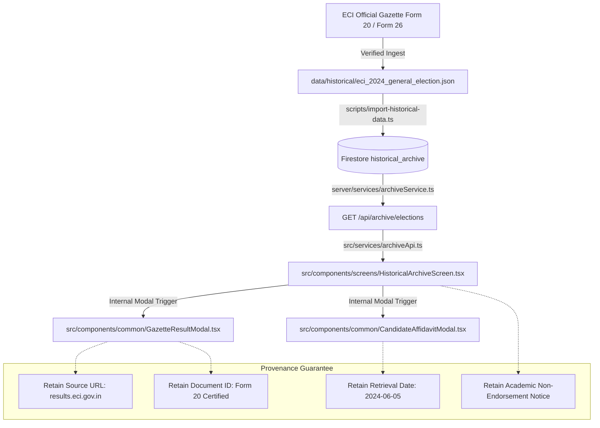

# BlockBallot — Comprehensive Project Structure & Architecture Guide

**Version:** 1.0.0  
**Target Environment:** Node.js (v22+), React 19, TypeScript 5+, Vite 8 (Rolldown engine), Hardhat (Solidity 0.8.20)  
**Authoritative Baseline:** Commit `4f3fb01` (`test(security): complete final audit and release readiness review`)  
**Active Working Branch:** `feature/simulation-voter-registry-rbac`  
**Classification:** Academic E-Voting Research Prototype & Simulation Architecture  

---

## 1. High-Level Directory Overview

```text
BlockBallot-EVoting-System/
│
├── src/                                  # Frontend Single-Page Application (React 19 + TypeScript)
│   ├── app/                              # Layout, application scaffolding & root entry
│   ├── components/                       # UI presentation components
│   │   ├── common/                       # Shared modal dialogs, icons, indicators & party symbols
│   │   │   ├── CandidateAffidavitModal.tsx # Form 26 local candidate affidavit & asset viewer
│   │   │   ├── ConfirmationModal.tsx     # Reusable action confirmation modal
│   │   │   ├── GazetteResultModal.tsx    # Form 20 official constituency gazette viewer
│   │   │   ├── OfficialPartySymbol.tsx   # ECI official political party symbol renderer
│   │   │   ├── StatusBadge.tsx           # Election & voter status pill tags
│   │   │   └── ...                       # Additional common visual elements
│   │   ├── screens/                      # Screen views (Voter, Officer, Public Monitor, Archive)
│   │   │   ├── AdminAuditScreen.tsx      # Security event logs & immutable audit trail
│   │   │   ├── AdminCandidatesScreen.tsx # Candidate roster & nomination management
│   │   │   ├── AdminDashboardScreen.tsx  # Role-specific Election Officer & VRO hub
│   │   │   ├── AdminElectionsScreen.tsx  # Election lifecycle management & scheduling
│   │   │   ├── AdminExceptionsScreen.tsx # Manual physical ID exception authorizations
│   │   │   ├── AdminLoginScreen.tsx      # Cryptographic officer authentication
│   │   │   ├── AdminVotersScreen.tsx     # Voter roll search, status toggles & review
│   │   │   ├── AvailableElectionsScreen.tsx # Public list of active, scheduled & archived polls
│   │   │   ├── CandidatesPartiesScreen.tsx # 2024 political party register & symbol references
│   │   │   ├── CandidatesScreen.tsx      # Ballot candidate selection (voting workflow)
│   │   │   ├── ConstituencyInfoScreen.tsx # 543 Parliamentary constituency profiles & gazette view
│   │   │   ├── ConstituencyScreen.tsx    # Voter constituency lock & jurisdiction verification
│   │   │   ├── ElectionMonitorScreen.tsx # Public real-time participation & node metrics
│   │   │   ├── ElectionsResultsScreen.tsx # Concluded election tallies & historical records
│   │   │   ├── FaceEnrollmentScreen.tsx  # Optical face template capture & vectorization
│   │   │   ├── FingerprintEnrollmentScreen.tsx # Minutiae extraction & biometric registration
│   │   │   ├── HistoricalArchiveScreen.tsx # Full 2024 General Election searchable archive
│   │   │   ├── HomeScreen.tsx            # Public landing screen & voting practice entry
│   │   │   ├── HowItWorksScreen.tsx      # Academic architecture walkthrough & protocols
│   │   │   ├── IdentifyScreen.tsx        # Voter EPIC identification & biometric challenge
│   │   │   ├── MetaMaskScreen.tsx        # Web3 wallet connection & EVM submission
│   │   │   ├── OtpScreen.tsx             # Out-of-band delivery challenge verification
│   │   │   ├── PracticeVotingScreen.tsx  # Sandboxed mock voting simulator (zero EVM impact)
│   │   │   ├── PreferencePollScreen.tsx  # Public opinion survey (isolated from elections)
│   │   │   ├── ReceiptScreen.tsx         # Cryptographic vote receipt & verification hash
│   │   │   └── ReviewScreen.tsx          # Elector ballot review prior to EIP-712 signing
│   │   ├── Navbar.tsx                    # Top navigation, language selector & jurisdiction pill
│   │   ├── PersonaQuickBar.tsx           # Zero-runtime component (returns null; production compliant)
│   │   └── VotingStepper.tsx             # 5-step voting progress indicator
│   ├── context/                          # Global React contexts (LanguageContext, etc.)
│   ├── data/                             # Mock data & static reference records
│   │   ├── historical2024.ts             # 2024 Lok Sabha constituency profiles & parties
│   │   └── mockData.ts                   # Initial simulation elections & test constituencies
│   ├── services/                         # Frontend API clients & gateway adapters
│   │   ├── archiveApi.ts                 # Historical archive HTTP client
│   │   ├── electionMonitorApi.ts         # Public election monitor HTTP client
│   │   ├── officerApi.ts                 # Officer authentication & administrative commands
│   │   ├── sessionApi.ts                 # Voter session authorization & recovery client
│   │   └── voterApi.ts                   # Elector identification & challenge gateway
│   ├── test/                             # Automated test suites (Phases 01 through 13)
│   │   ├── phase01_demo_voters_removal.test.ts
│   │   ├── phase02_voter_roll_registration.test.ts
│   │   ├── phase03_face_enrollment_verification.test.ts
│   │   ├── phase04_fingerprint_enrollment.test.ts
│   │   ├── phase05_manual_id_verification.test.ts
│   │   ├── phase06_election_schedule_transition.test.ts
│   │   ├── phase07_session_security_anti_replay.test.ts
│   │   ├── phase08_tamper_resistant_audit.test.ts
│   │   ├── phase09_historical_archive_pipeline.test.ts
│   │   ├── phase10_election_monitor_dashboard.test.ts
│   │   ├── phase11_production_security_hardening.test.ts
│   │   ├── phase12_ui_ux_integration.test.ts
│   │   └── phase13_final_security_audit.test.ts
│   ├── types/                            # Core TypeScript interface definitions
│   │   ├── archive.ts                    # Historical election record & provenance schemas
│   │   ├── audit.ts                      # Immutable security audit log schemas
│   │   ├── biometric.ts                  # Biometric template & minutiae metadata schemas
│   │   └── index.ts                      # Central domain entities (Voter, Election, Candidate)
│   ├── utils/                            # Client-side utility functions
│   │   ├── crypto.ts                     # Web Crypto hashing & EIP-712 signature verification
│   │   └── evmSimulator.ts               # Local in-browser EVM execution fallback
│   ├── App.tsx                           # Master routing & screen controller
│   ├── index.css                         # Tailwind CSS v4 styling rules & custom themes
│   └── main.tsx                          # React 19 root DOM mounting entrypoint
│
├── server/                               # Backend Node.js / Express Server (TypeScript)
│   ├── auth/                             # Role-Based Access Control & Session Token Security
│   │   ├── rbac.ts                       # EO, VRO, Admin role policies & action checks
│   │   └── sessionToken.ts               # HMAC-SHA256 authenticated session token generator
│   ├── config/                           # Configuration loaders & schema validation
│   │   └── environment.ts                # Strict fail-closed environment variable parser
│   ├── middleware/                       # Request processing middleware
│   │   ├── auditLogger.ts                # Structured security audit event logger
│   │   ├── rateLimiter.ts                # IP & EPIC rate limiting algorithms
│   │   └── requestValidator.ts           # Joi/Zod request payload sanitizers
│   ├── repositories/                     # Persistence abstraction layer
│   │   ├── archiveRepository.ts          # Historical election document store
│   │   ├── auditRepository.ts            # Immutable append-only audit event sink
│   │   ├── electionRepository.ts         # Active simulation election schedules & tallies
│   │   ├── sessionRepository.ts          # High-entropy voter session registry
│   │   └── voterRepository.ts            # Elector profiles, biometric metadata & status
│   ├── routes/                           # Express HTTP route controllers
│   │   ├── archiveRoutes.ts              # /api/archive/elections endpoints
│   │   ├── auditRoutes.ts                # /api/audit endpoints
│   │   ├── electionRoutes.ts             # /api/elections endpoints
│   │   ├── monitorRoutes.ts              # /api/monitor endpoints
│   │   ├── officerRoutes.ts              # /api/officer authentication & controls
│   │   └── voterRoutes.ts                # /api/voter identification & challenge routes
│   ├── security/                         # Cryptographic key stores & data protection
│   │   ├── encryption.ts                 # AES-256-GCM envelope encryption for PII
│   │   └── secureHeaders.ts              # CSP, HSTS, and frame protection headers
│   ├── services/                         # Core domain business logic
│   │   ├── archiveService.ts             # Archive querying, search & pagination logic
│   │   ├── biometricService.ts           # Template hashing & matching algorithms
│   │   ├── electionLifecycleService.ts   # Authoritative schedule transition engine
│   │   ├── exceptionService.ts           # Physical ID exception validation & expiration
│   │   ├── participationService.ts       # Per-election vote state & double-vote prevention
│   │   └── verificationService.ts        # Voter verification & out-of-band delivery logic
│   └── index.ts                          # Express application initialization & router mounting
│
├── database/                             # Database Schemas, Rules & Migrations
│   ├── migrations/                       # Versioned Firestore data transformation scripts
│   ├── rules/                            # Firestore security rules
│   │   └── firestore.rules               # Architectural copy of database access control rules
│   └── README.md                         # Database architecture, collection schemas & indexes
│
├── contracts/                            # Solidity Smart Contracts
│   ├── BlockBallot.sol                   # Primary voting smart contract (EIP-712 verification)
│   └── mock/                             # Test mocks & Hardhat contract helpers
│
├── data/                                 # Authoritative Datasets
│   └── historical/                       # Verified external historical records
│       └── eci_2024_general_election.json # 2024 Lok Sabha certified constituency results
│
├── docs/                                 # Architectural & Security Documentation
│   ├── CODEBASE_AUDIT.md                 # Initial audit & gap analysis report
│   ├── CODEBASE_REFACTOR_REPORT.md       # Final completion, metrics & verification report
│   ├── KNOWN_LIMITATIONS.md              # Documented cryptographic ballot-secrecy limitation
│   ├── PHASE12_UI_UX_AUDIT.md            # Frontend accessibility & screen inventory
│   ├── PHASE13_FINAL_SECURITY_AUDIT.md   # Final release audit & 25-step security verification
│   ├── PROJECT_STRUCTURE.md              # This document
│   ├── RELEASE_READINESS.md              # Release verdict: Academic simulation only; public blocked
│   └── STAGING_RUNBOOK.md                # Deployment, migration & operational runbook
│
├── scripts/                              # Utility & Maintenance Scripts
│   ├── deploy.ts                         # Hardhat contract deployment script
│   ├── import-historical-data.ts         # Idempotent historical data importer (dry-run first)
│   └── seed-demo-admin.ts                # Development admin seeder (isolated from production)
│
├── .env.example                          # Safe environment variable template (no secrets)
├── .firebaserc                           # Firebase project configuration
├── firebase.json                         # Firebase hosting, rules & emulator setup
├── firestore.rules                       # Root Firestore security rules (referenced by CLI & tests)
├── hardhat.config.cjs                    # Hardhat EVM network & compiler configuration
├── index.html                            # HTML5 entrypoint with CSP & viewport meta tags
├── package.json                          # Dependencies, scripts & build metadata
├── README.md                             # Repository overview, setup instructions & provenance
├── render.yaml                           # Backend deployment configuration
├── server.ts                             # Root server execution entrypoint
├── tsconfig.json                         # TypeScript compiler configuration
└── vite.config.ts                        # Vite 8 / Rolldown build & chunking configuration
```

---

## 2. Component Boundaries & Responsibilities

### 2.1 Frontend Presentation (`src/`)
- **Isolation Principle**: Pure presentation and user interaction. Contains **no** private cryptographic signing keys, server secrets, or direct database credentials.
- **State Separation**:
  - `currentScreen`: State-driven screen router managing voter journeys and officer consoles.
  - `LanguageContext`: Hindi (`hi`) and English (`en`) bilingual localization without external API dependencies.
  - `evmSimulator`: Purely local fallback EVM execution engine for offline demonstrations.
- **Modals & Overlays**:
  - `GazetteResultModal.tsx`: Displays certified Form 20 constituency results without leaving the application.
  - `CandidateAffidavitModal.tsx`: Displays verified Form 26 candidate demographic, financial, and educational declarations locally.

### 2.2 Backend Application (`server/` & `server.ts`)
- **Authoritative Enforcement**: All voter eligibility, session timeouts, biometric template matching, lifecycle state transitions, and audit records are computed and validated exclusively on the server.
- **Fail-Closed Security**: In production mode (`NODE_ENV=production`), missing cryptographic master keys (`SERVER_ENCRYPTION_KEY`, `TICKET_SIGNER_PRIVATE_KEY`) or absent Firebase credentials trigger immediate process termination (`process.exit(1)`).
- **Session Lifecycle**: High-entropy, crypto-random session tokens expire in 15 minutes and bind strictly to a single election and constituency.

### 2.3 Database Management (`database/` & `firestore.rules`)
- **Architecture**: Google Cloud Firestore managed document store.
- **Collections Architecture**:
  1. `voters`: Elector profile, constituency ID, status (`ACTIVE`, `INELIGIBLE`), biometric vector references.
  2. `voter_participation`: Per-election participation records (`ELIGIBLE`, `SESSION_ISSUED`, `VOTED`).
  3. `sessions`: Ephemeral voting sessions and authorization tickets.
  4. `elections`: Simulation election definitions, start/end timestamps, and status (`SCHEDULED`, `ACTIVE`, `CONCLUDED`).
  5. `candidates`: Candidate profiles, party affiliations, and EVM candidate indices.
  6. `audit_log`: Append-only, immutable security event log.
  7. `historical_archive`: Sourced 2024 General Election records preserved in immutable collections.
  8. `public_monitor`: Projected, privacy-preserving aggregate metrics.
- **Access Rule**: All writes to operational collections require server-side Firebase Admin credentials; client direct writes are rejected (`allow write: if false;`).

### 2.4 Blockchain Layer (`contracts/`)
- **Contract**: `BlockBallot.sol` (Solidity 0.8.20 with OpenZeppelin `EIP712` and `ReentrancyGuard`).
- **Authorization**: Requires an EIP-712 typed signature from the authoritative server's `TICKET_SIGNER_ADDRESS`.
- **Known Limitation**: In accordance with `docs/KNOWN_LIMITATIONS.md` and Phase 13 findings (`BB-SEC-PH09-BALLOT-SECRECY`), candidate choices in transaction calldata and `VoteCast` events are publicly visible on EVM ledgers. Public elections remain blocked until zero-knowledge proofs or confidential computing are implemented.

---

## 3. Data Flow & Provenance Architecture



---

## 4. Build, Lint & Test Tooling

| Task | Command | Description |
|---|---|---|
| **TypeScript Check** | `npm run lint` | Runs `tsc --noEmit` across full codebase (strict mode). |
| **Vite Production Build** | `npm run build` | Compiles frontend into optimized bundles (`dist/`) via Rolldown. |
| **Complete Test Suite** | `npm test` | Executes all 24+ test files (324+ tests) using Node.js test runner. |
| **Phase 13 Security Audit** | `npx tsx --test src/test/phase13_final_security_audit.test.ts` | Runs the authoritative 25-step security verification suite. |
| **Start Frontend Dev** | `npm run dev` | Launches Vite HMR development server on `http://localhost:5173`. |
| **Start Backend Dev** | `npm run server:dev` | Launches Express server with hot-reload via `tsx watch`. |
| **Firestore Emulator** | `npm run emulator:start` | Launches local Firestore emulator on port 8080. |
| **Emulator Integration** | `npm run emulator:test` | Runs emulator-backed integration tests in isolated environment. |
| **Contract Deploy** | `npm run contract:deploy` | Deploys `BlockBallot.sol` to local Hardhat node (port 8545). |
| **Historical Data Import** | `npm run archive:import` | Imports certified 2024 election dataset into Firestore. |

---

## 5. Artifacts, Caches & Generated Directories

The following directories contain generated files and are explicitly excluded from version control in `.gitignore`:

- `dist/`: Frontend static production bundle produced by `npm run build`.
- `artifacts/`: Hardhat compilation output containing EVM bytecode and contract ABIs.
- `cache/`: Hardhat and build-tool temporary compiler cache.
- `node_modules/`: Local NPM dependency tree.
- `firestore-debug.log`: Local Firestore emulator operational log.
- `.env.local`: Local secret overrides (strictly ignored by Git).
