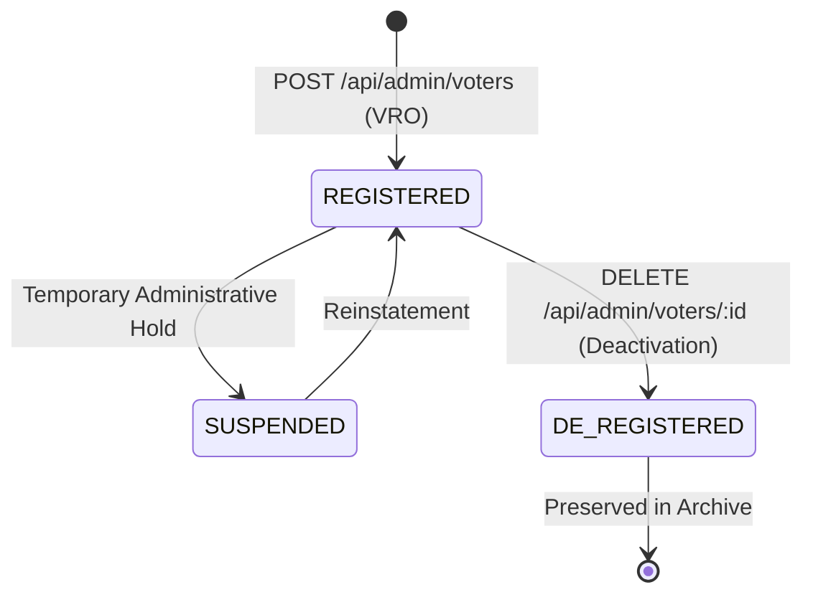
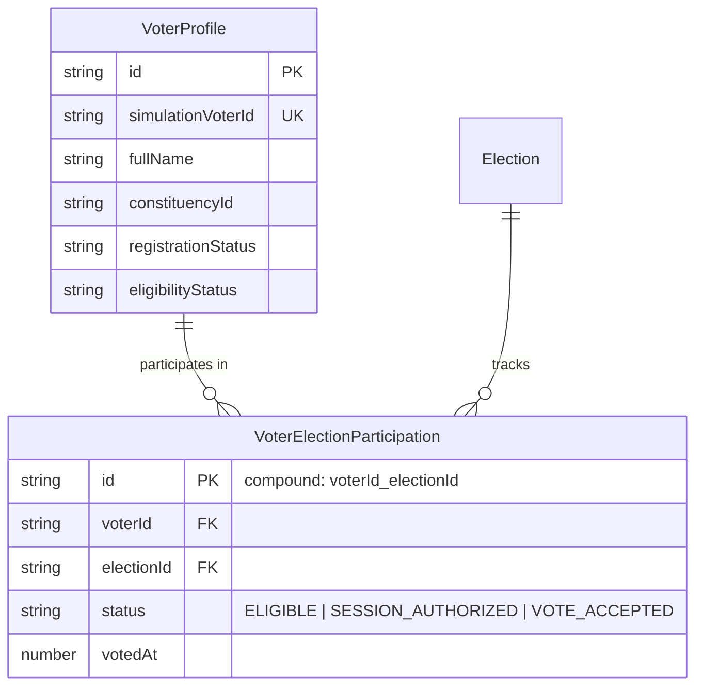

# BlockBallot — Voter Registry and Backend-Generated Simulation IDs

> **Academic Prototype & Research Architecture Notice**  
> This specification documents the persistent voter registry and backend simulation ID generation system for the BlockBallot academic election simulation system (Phase 04).  
> **DISCLAIMER:** All elector identifiers generated by this system (format: `BBV-SIM-<token>`) are strictly synthetic simulation tokens created for local testing and research evaluation. They do **not** represent authentic Election Commission of India (ECI) voter IDs or official Elector Photo Identity Card (EPIC) documents, do not integrate with live government identity databases (such as UIDAI or ECI NVSP/ERMS), and must not be used to impersonate official Indian electoral credentials.

---

## 1. Overview and Architecture

In Phase 04, BlockBallot establishes a persistent simulation voter registry backed by the versioned `VoterProfile` data model and repository layer. All voter identifiers are generated strictly on the backend using cryptographic entropy, preventing client-side identifier injection, collisions, or impersonation of official government identity numbers.

```mermaid
graph TD
    subgraph Officer Client
        VRO["Voter Registration Officer<br/><code>VRO-SIM-001</code>"]
        EO["Election Officer<br/><code>EO-SIM-001</code>"]
    end

    subgraph Express Backend & RBAC
        AUTH["authenticateOfficer Middleware"]
        RBAC["requirePermission('VOTER_CREATE')"]
        VAL["Validation Engine<br/>Age ≥ 18 · Geographic Scope · Bio Payload Check"]
        IDGEN["Node.js Crypto Generator<br/><code>BBV-SIM-&lt;token&gt;</code> + Collision Retry"]
    end

    subgraph Data Persistence
        REPO["IVoterProfileRepository<br/>(InMemory / Firestore)"]
        BIO_REPO["IBiometricMetadataRepository<br/>(Face & Fingerprint Stubs: NOT_STARTED)"]
        AUDIT["Structured Audit Trail"]
        CACHE["ServerStore Voter Cache"]
    end

    VRO -->|POST /api/admin/voters| AUTH
    EO -.->|POST /api/admin/voters (403 Forbidden)| AUTH
    AUTH --> RBAC
    RBAC --> VAL
    VAL --> IDGEN
    IDGEN --> REPO
    REPO --> BIO_REPO
    REPO --> AUDIT
    REPO --> CACHE
```

---

## 2. Simulation Voter ID Format

### 2.1 Specification
- **Prefix**: `BBV-SIM-` (BlockBallot Voter Simulation).
- **Entropy Token**: 8 cryptographically random characters chosen from an unambiguous uppercase alphanumeric character set (`ABCDEFGHJKLMNPQRSTUVWXYZ23456789`, excluding ambiguous characters `0`, `O`, `1`, `I`).
- **Example Generated IDs**:
  - `BBV-SIM-7K9M2X4W`
  - `BBV-SIM-M4N8P2R7`
  - `BBV-SIM-D9T2V5Y3`

### 2.2 Security & Compliance Invariants
1. **Server-Owned**: Generated exclusively on the server using Node.js `crypto.randomInt` or `crypto.randomBytes`. Any client-supplied ID in registration payloads is strictly ignored or rejected.
2. **Distinct from Real EPIC Formats**: Standard Indian ECI EPIC cards follow the format `^[A-Z]{3}[0-9]{7}$` (3 uppercase letters followed by 7 numeric digits). The system's validator `isRealEpicFormat()` explicitly detects and forbids assigning real-EPIC-shaped identifiers.
3. **Collision Resilience**: The generator queries persistent storage (`repos.voterProfiles.findBySimulationId`) and automatically retries up to 10 times in the astronomically unlikely event of a collision.
4. **Unforgeable Existence**: A well-formed string alone does not prove an elector exists. Every lookup performs an authoritative query against persistent storage.

---

## 3. Registration Workflow & Validation

### 3.1 Enrollment Workflow
1. **Officer Authentication**: The registration officer authenticates and supplies an active bearer token issued to `VRO-SIM-001` or `PLATFORM_ADMIN`.
2. **Permission Check**: The endpoint evaluates `requirePermission('VOTER_CREATE')`. Unauthenticated requests return `401 Unauthorized`; unauthorized roles (such as `EO-SIM-001`) return `403 Forbidden`.
3. **Scope Verification**: The officer's server-managed assignment scope is checked against the target `constituencyId`. For `VRO-SIM-001`, registrations are permitted only within `CONST-04-ND` (New Delhi).
4. **Biometric Prohibition Guard**: The request body is inspected for forbidden biometric payloads (`rawImage`, `fingerprintTemplate`, `minutiae`, `photo`, etc.). If any biometric payload field is present, the request is immediately rejected with `400 Bad Request`.
5. **Field Validation**:
   - `fullName`: Required string (minimum 2 characters).
   - `dateOfBirth`: Required canonical ISO 8601 string (`YYYY-MM-DD`).
   - `age`: Calculated server-side; must be $\ge 18$ years of age on registration date.
   - `gender`: Restricted to `'M'`, `'F'`, or `'O'`.
   - `constituencyId`: Must reference an active constituency in the electoral roll registry.
   - `pollingStation`: Designates assigned polling booth.
   - `maskedMobile`: Mobile number representation for simulation OTP challenge delivery.
6. **ID Generation & Persistence**: The unique `BBV-SIM-...` identifier is generated. The record is persisted to `IVoterProfileRepository`.
7. **Biometric Stub Initialization**: Initial metadata records for `FACE` and `FINGERPRINT` modalities are created with `status: 'NOT_STARTED'` and `qualityCheckStatus: 'PENDING'`.
8. **Audit Logging & Response**: A structured audit event is appended to the audit repository, and HTTP `201 Created` is returned containing the assigned simulation ID and sanitized profile.

---

## 4. API Endpoints

All voter administration endpoints are mounted under `/api/admin/voters`:

| Method | Route | Required Permission | Description |
| :--- | :--- | :--- | :--- |
| `POST` | `/api/admin/voters` | `VOTER_CREATE` | Enrolls a new synthetic voter profile with a server-generated simulation ID. |
| `GET` | `/api/admin/voters` | `VOTER_READ` | Lists voter records within officer's authorized assignment scope. Supports `search` and `constituencyId` query parameters. |
| `GET` | `/api/admin/voters/:id` | `VOTER_READ` | Retrieves voter profile by internal ID or simulation voter ID along with biometric status metadata. |
| `PATCH` | `/api/admin/voters/:id` | `VOTER_UPDATE` | Updates permitted demographic fields (`fullName`, `dateOfBirth`, `gender`, `constituencyId`, `pollingStation`, `maskedMobile`, `isEligible`). Rejects immutable fields. |
| `DELETE` | `/api/admin/voters/:id` | `VOTER_DEACTIVATE` | Performs safe lifecycle deactivation (soft delete). Transitions registration to `DE_REGISTERED` and lifecycle to `ARCHIVED`. |
| `PATCH` | `/api/admin/voters/:id/eligibility` | `VOTER_UPDATE` | Legacy compatibility endpoint for toggling electoral eligibility. |

---

## 5. Record Lifecycle & Deactivation Safeguards



### 5.1 Safe Soft-Deactivation
- BlockBallot **never hard-deletes** voter identity records from the database.
- Calling `DELETE /api/admin/voters/:id`:
  - Sets `registrationStatus = 'DE_REGISTERED'`.
  - Sets `eligibilityStatus = 'INELIGIBLE_DISQUALIFIED'`.
  - Sets `lifecycleStatus = 'ARCHIVED'`.
  - Clears any pending authentication session or authorization ticket.
- **Future Voting Prohibited**: The voter identification gateway immediately rejects deactivated voters with `403 Forbidden` (`status: 'INELIGIBLE'`).
- **Past Ballots Preserved**: Accepted on-chain votes, nullifiers, and receipts remain completely intact. Deactivation cannot alter past election results or audit events.

---

## 6. Biometric Metadata Enrollment States (Phase 04 Stubs)

In Phase 04, no biometric hardware, scanners, camera feeds, or face matching algorithms are implemented. Instead, two metadata stubs are initialized in `IBiometricMetadataRepository` upon voter enrollment:

| Modality | Default Status | Quality Check Status | Manual Exception |
| :--- | :--- | :--- | :--- |
| `FACE` | `NOT_STARTED` | `PENDING` | `false` |
| `FINGERPRINT` | `NOT_STARTED` | `PENDING` | `false` |

- A newly registered voter is **never** reported as `ENROLLED`.
- Physical biometric enrollment pages, SDK adapters, and device drivers will be implemented in Phase 05.
- Manual exception review workflows will be implemented in Phase 06.

---

## 7. Multiple-Election Participation Model

Electors are registered once as reusable simulation identities (`VoterProfile`) and participate in individual elections via independent `VoterElectionParticipation` records:



- A voter who has cast a ballot in Election 1 (`status: 'VOTE_ACCEPTED'`) retains independent eligibility in Election 2 (`status: 'ELIGIBLE'`).
- Voting history is tracked per-election rather than using a single global boolean flag.

---

## 8. Audit Trail Events

The voter registry records structured audit events for every state mutation and access denial:

| Action | Event Type | Description Pattern |
| :--- | :--- | :--- |
| **Voter Created** | `ADMIN_ACTION` | `Voter profile created: 'BBV-SIM-...' in constituency '...' by officer 'VRO-SIM-001'` |
| **Voter Updated** | `ADMIN_ACTION` | `Voter profile updated: 'BBV-SIM-...' (fields: ...) by officer 'VRO-SIM-001'` |
| **Voter Deactivated** | `ADMIN_ACTION` | `Voter record deactivated: 'BBV-SIM-...' in constituency '...' by officer 'VRO-SIM-001'` |
| **Biometric Payload Rejected** | `ADMIN_ACTION` | `Rejected voter registration attempt: Prohibited biometric field '...' submitted by '...'` |
| **Underage Registration Rejected** | `ADMIN_ACTION` | `Voter registration rejected: Age ... is under statutory minimum (18) for registration by '...'` |
| **Scope Violation** | `ADMIN_ACTION` | `Scope violation: Account '...' attempted creating voter in out-of-scope constituency '...'` |
| **Unauthorized Attempt** | `ADMIN_ACTION` | `Access denied: Account 'EO-SIM-001' attempted action requiring 'VOTER_CREATE'` |

Audit logs contain timestamps, officer identifiers, constituency references, and failure reasons. They never log passwords, tokens, OTPs, or biometric payloads.

---

## 9. Legacy Compatibility Paths

To ensure existing Phase 01, Phase 02, and Phase 03 flows continue to function without breaking Solidity smart contracts:
1. **Runtime Voter Cache Sync**: When a `VoterProfile` is created, updated, or deactivated, `serverStore.setVoterRecord()` synchronizes an in-memory `VoterRecord` using `epicId: profile.simulationVoterId`.
2. **Identification Gateway Adapter**: `serverStore.findVoterByEpicAsync()` checks `repos.voterProfiles.findBySimulationId()` and `findByLegacyEpic()`, adapting the profile into a `VoterRecord` for OTP verification and EIP-712 authorization signing.
3. **EPIC Format Validation**: `isValidEpicFormat()` accepts both legacy 10-character formats and the simulation voter format (`^BBV-SIM-[A-Z0-9-]+$`).
4. **Deferred Migration**: Full migration of all remaining legacy status references to pure `VoterElectionParticipation` will be completed in Phase 08.

---

## 10. Summary of Phase Boundaries

| Feature | Phase 04 (Current) | Phase 05 | Phase 06 | Phase 07 | Phase 08 |
| :--- | :---: | :---: | :---: | :---: | :---: |
| **Persistent Voter Roll** | **Implemented** | Active | Active | Active | Active |
| **Backend-Generated Simulation IDs** | **Implemented** | Active | Active | Active | Active |
| **VRO Role Authorization & Scope** | **Implemented** | Active | Active | Active | Active |
| **Biometric Metadata Stubs (`NOT_STARTED`)** | **Implemented** | Active | Active | Active | Active |
| **Face & Fingerprint Hardware Enrollment** | *Deferred* | **Phase 05** | Active | Active | Active |
| **Physical-ID Exception Approvals (EO)** | *Deferred* | Deferred | **Phase 06** | Active | Active |
| **Automated Election Timers & Cron** | *Deferred* | Deferred | Deferred | **Phase 07** | Active |
| **Full Legacy Model Retirement** | *Deferred* | Deferred | Deferred | Deferred | **Phase 08** |
